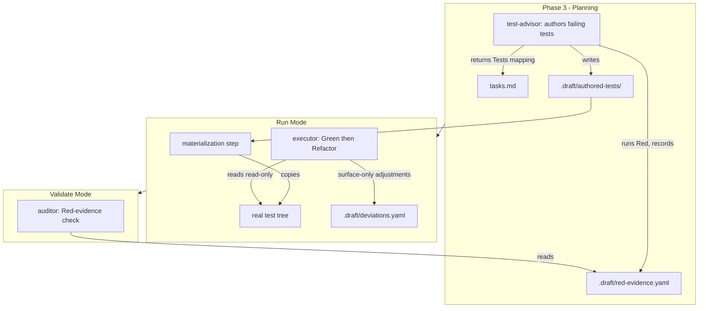
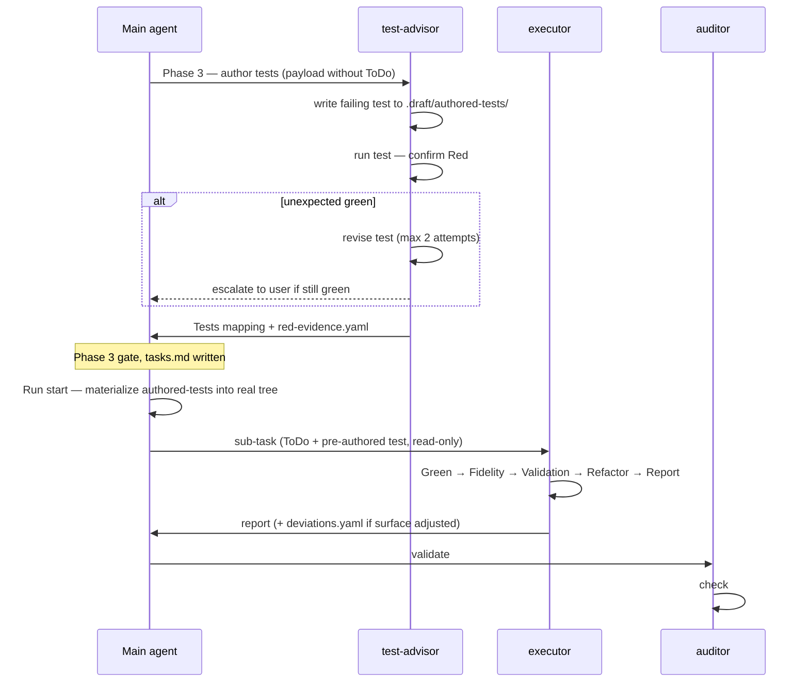

# Design - Test-First Execution with Independent Test Authorship

## Overview

Test-first execution is realized by reassigning ownership of test authorship from the `executor` to the `test-advisor`, separating the context each persona receives, and adding a Red-phase verification at planning time. No new sub-agent is introduced and no new hook is added — the change is concentrated in three agent definitions, four reference documents, and two consistency surfaces. The executor's protocol **remains six steps**; only step 5 becomes conditional (Refactor vs Tests), which keeps the widely-referenced "6-step protocol" name intact and minimizes documentation churn.

## Architecture



## Components & Interfaces

### test-advisor (test author)

- **Responsibility:** During Phase 3, author one failing test file per sub-task whose Tests field type is Unit or Integration; run each test to confirm it fails (Red); record Red evidence. Continues to return the Tests-field mapping for `tasks.md`.
- **Interface (frontmatter):** `tools` gains `Write` and `Bash`; `maxTurns` raised `15 → 30` (authoring + running tests); `effort` raised `medium → high`.
- **Authoring payload (per sub-task) — what it receives:** EARS requirement text, sub-task Objective, Tests scenarios, project test conventions, and — Full mode only — the relevant `design.md` contract excerpt. **It does NOT receive the `ToDo` field** (R2.2).
- **Standard-mode contract (R2.3 / gotcha G2):** when no `design.md` exists, the contract is the Objective + EARS requirement + Tests scenarios only. Tests authored this way are behavior-level, not signature-pinned; signature drift is absorbed by the executor's audited surface exception.
- **Dependencies:** `story.md`, `tasks.md` (draft task list), `design.md` (Full only).
- **Pre-existing defect to fix while editing:** the file has a duplicated `## Rules` heading — merge into one.

### executor (Green-then-Refactor)

- **Responsibility:** For a sub-task that has a pre-authored test, make that test pass and then refactor; for a sub-task without one, behave exactly as today.
- **Interface — the six-step protocol, step 5 conditional:**

  | Step | Test-first sub-task | Test-after sub-task (unchanged) |
  |---|---|---|
  | 1 | Context gathering | Context gathering |
  | 2 | Implementation (**Green** — make the pre-authored test pass) | Implementation |
  | 3 | Design Fidelity Check | Design Fidelity Check |
  | 4 | Validation | Validation |
  | 5 | **Refactor** (improve code; test + validation stay green) | Tests (author tests) |
  | 6 | Report | Report |

- **Frozen-test rule (R4):** the pre-authored test is a read-only input. Assertions MUST NOT be modified. Imports / signature call-sites MAY be adjusted only to match an INTENTIONAL design deviation found in step 3, and each such adjustment is recorded in `.draft/deviations.yaml` with `test_surface_adjusted: true`.
- **Behavior-changing deviation (R4.3 / gotcha G1):** if a design deviation would change what an assertion expects, the executor STOPS and escalates — it never edits an assertion.
- **Dependencies:** `tasks.md`, materialized test files, `design.md` (Full), `.draft/deviations.yaml`.

### auditor (Red-evidence check)

- **Responsibility:** Adds one check to its existing 9 — verify every test-first sub-task has a Red-evidence entry.
- **Interface:** new check #10 — "Red precedence: every sub-task with a pre-authored test has an entry in `.draft/red-evidence.yaml` with `failed: true`." Since Red evidence is recorded in Phase 3 and implementation happens in Run, the entry's existence establishes precedence by construction.
- **Dependencies:** `.draft/red-evidence.yaml`, `tasks.md`.

### Orchestration surfaces (reference docs)

- **`references/phase-gates.md`** — the Test-Advisor sub-agent prompt template is rewritten: planner → author, adds the authoring payload, the context boundary (no `ToDo`), and the Red-verification + record step.
- **`references/run-mode.md`** — (a) a **materialization step** added to the Procedure: before task execution, copy `.draft/authored-tests/**` into the real test tree; (b) the Executor Prompt Template gains a "Pre-Authored Test" section and the step-5-conditional protocol.
- **`references/tasks.md`** — documents that `.draft/authored-tests/` holds authored failing tests during planning and that Red evidence is recorded; the Tests field is now *authored*, not merely *specified*.
- **`references/validate-mode.md`** — the Auditor prompt blockquote gains check #10.

### Consistency surfaces

- **`skills/epic/SKILL.md`** — persona table: test-advisor role line ("defines test strategy" → "authors failing tests"); the executor row notes step 5 is conditional.
- **`ARCHITECTURE.md`** — §Executor 6-step protocol (step 5 conditional + Refactor), §Sub-agent pipeline Tool-scoping (test-advisor is no longer read-only — gotcha G5), §Artifact contracts (`.draft/` layout adds `authored-tests/` and `red-evidence.yaml`), §Validation layers (Red evidence as an auditor gate).
- **`README.md`** — sub-agent table descriptions; the "context → impl → fidelity → validation → tests → report" prose appears twice (lines 16, 137) — both updated to reflect the conditional step 5.

## Data Models

New artifacts inside the story's `.draft/` directory (gitignored):

```
.epic/stories/NNN-name/.draft/
├── authored-tests/        # failing test files, authored Phase 3
│   └── <mirror of target test path>
├── red-evidence.yaml      # Red verification record (new)
├── deviations.yaml        # existing — now also carries test_surface_adjusted
├── story.md
├── design.md
└── meta.yaml
```

`red-evidence.yaml` shape:

```yaml
red-evidence:
  - task: "2.1"
    test_file: ".draft/authored-tests/tests/foo.test.ts"
    target_path: "tests/foo.test.ts"
    command: "npm test -- foo"
    failed: true
    reason: "ReferenceError: validateEmail is not defined"
    recorded: 2026-05-17
```

## Sequence Diagram — test-first sub-task lifecycle



## Error Handling Strategy

- **Unexpected green (R5.3/R5.4):** Phase 3 blocks; test-advisor revises up to **2 times**; if still green, escalate to the user. Mirrors the existing Tech Review 2-cycle cap.
- **Missing design contract (Standard mode):** fall back to Objective + EARS requirement + Tests scenarios — not an error.
- **Materialization collision:** if a target test path already exists in the real tree, skip that file and emit a warning (handles re-run / partial `run N.N` / executor-modified files). Materialization is therefore idempotent.
- **Behavior-changing design deviation:** executor STOPS and escalates rather than editing a frozen assertion.

## Security Considerations

- The test-advisor gains `Bash` to run test commands. It runs only the project's own test runner on the authored test files — no broader command surface is implied by this story.

## Testing Strategy

This story edits markdown agent/reference definitions, not executable logic — so it has **no Unit-level tests** (gotcha G3). Verification is regression-based:

- **Unit tests:** N/A — no logic code is added.
- **Integration tests:** the eval suite (`scripts/run-evals.sh`) must still pass; the `bats` script tests (`bats tests/`) must still pass — neither may regress from the documentation/prompt changes.
- **Structural validation:** `scripts/validate-story.sh` and `scripts/cross-reference.sh` pass on this story's own artifacts.
- **Consistency review:** the auditor verifies no documentation surface still describes the test-after protocol for testable Standard/Full sub-tasks (R7).

## Integration Points

- **Phase 3 gate** (`phase-gates.md`) — test-advisor now authors and Red-verifies before the gate.
- **Run mode start** (`run-mode.md`) — materialization step precedes task execution.
- **Executor prompt** (`run-mode.md`) — carries the pre-authored test as a read-only input.
- **Validate mode** (`validate-mode.md`) — auditor check #10.
- **`hook-validate.sh` (PostToolUse on `.epic/**`)** — the test-advisor writing to `.draft/authored-tests/` triggers this hook; it runs `validate-story.sh`, which on an incomplete story reports only the non-fatal "missing tasks.md" — tolerable, no hook change needed. Confirm during implementation that no spurious failure is surfaced.
