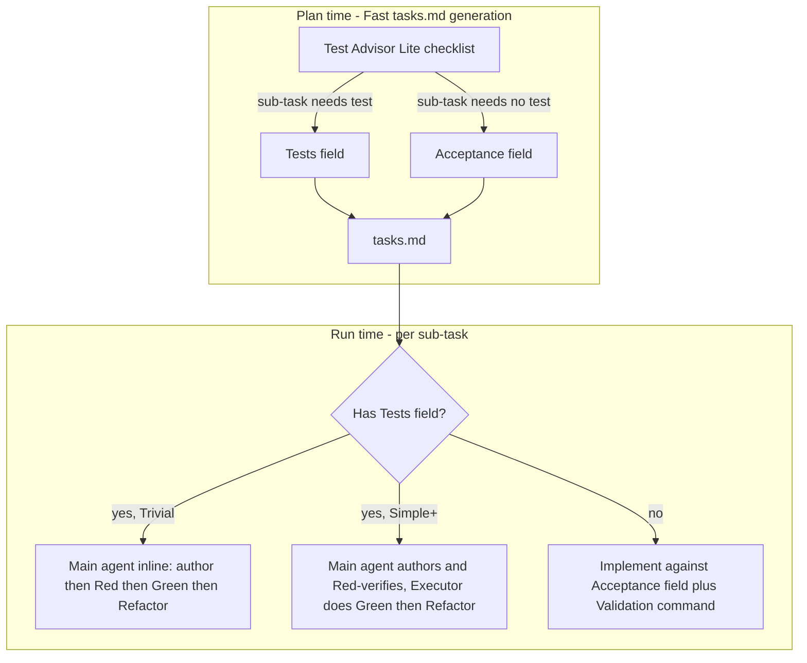
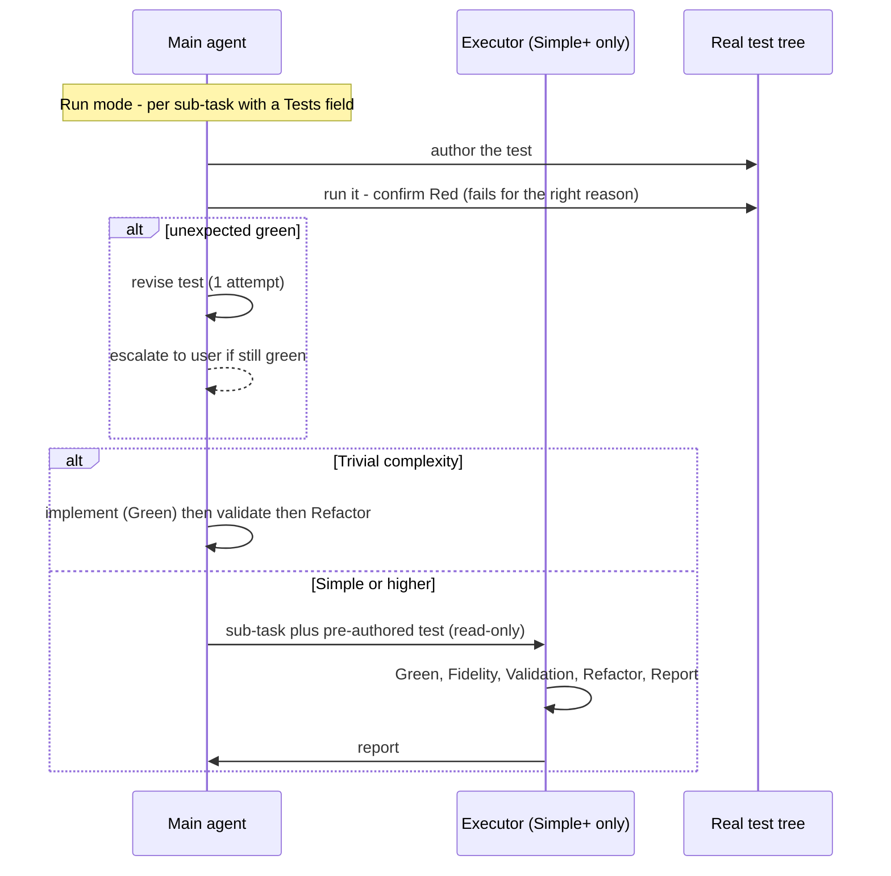

# Design - Fast-Mode Test-First Execution with Intent Anchor

## Overview

Fast-mode test-first is realized **entirely at run time** and reuses existing machinery — no new sub-agent, no `.draft/`, no `red-evidence.yaml`, and no change to `agents/executor.md`. At plan time the "Test Advisor Lite" checklist gains one rule: every implementing sub-task ends with either a `Tests` field or an `Acceptance` field. At run time, each sub-task carrying a `Tests` field receives test-first ordering — author the test, confirm it fails, implement to Green, then Refactor. Trivial sub-tasks run this inline in the main agent; Simple-or-higher sub-tasks have the main agent author and Red-verify the test, then hand it as a read-only input to the Executor, whose existing conditional step-5 protocol already covers it.

## Architecture



## Components & Interfaces

The change is concentrated in three behavioral surfaces, five consistency surfaces, and three verify-only surfaces. Enumerating all of them here is deliberate — story 001 shipped with `PURPOSE.md` left stale because its task plan under-enumerated the doc surfaces.

### Behavioral surfaces (logic changes)

#### `references/phase-gates.md` — Test Advisor Lite

- **Responsibility:** the plan-time checklist that decides Fast-mode testing.
- **Change:** extend the 3-check checklist with the **contract rule** — every implementing (non-Commit) sub-task ends with either a `Tests` field or an `Acceptance` field. Add a note that, unlike Standard/Full Phase 3, Fast does **not** author tests at plan time: the checklist still decides *whether* a test is needed; the test-first ordering itself happens at run time.

#### `references/run-mode.md` — run-time test-first for Fast

- **Responsibility:** the execution flow.
- **Change:** (a) add **run-time test-first ordering** for Fast sub-tasks carrying a `Tests` field — author the test, run it, confirm Red, then implement; (b) the **Trivial / Main-Agent-Inline** path explicitly authors-then-implements (single-author); (c) the **Simple+** path has the orchestrator author + Red-verify the test and pass it to the Executor as the read-only "Pre-Authored Test" input; (d) clarify that the existing **materialization step** (`.draft/authored-tests/**`) is Standard/Full-only — Fast writes the test straight into the real test tree.
- **Gotcha:** do not wire Fast into the `.draft/`-based materialization step — Fast has no draft staging.

#### `references/tasks.md` — the `Acceptance` field

- **Responsibility:** the `tasks.md` format reference.
- **Change:** document the `Acceptance` field in the Content Fields table and the Fast Scale Adaptations section: optional, Fast-only, sub-task-level, 1-3 observable-behavior statements; state the contract rule (test **or** `Acceptance`).

### Consistency surfaces (kept in sync)

- **`skills/epic/SKILL.md`** — the Gotchas list and Fast-mode description; note Fast is test-first; keep the Fast→Standard upgrade guidance (R6.2) explicit.
- **`assets/examples/fast-feature.md`** — update the example to show a test-first sub-task and an `Acceptance` field on a structural sub-task.
- **`README.md`** — the Design Principles and mode descriptions; "test-first" is no longer Standard/Full-only.
- **`ARCHITECTURE.md`** — §Validation layers and the Fast-mode references; the Executor reuse note.
- **`CHANGELOG.md`** — an `[Unreleased]` entry.

### Verify-only surfaces (confirm, change only if stale)

- **`PURPOSE.md`** — describes the Executor protocol generically; verify it does not describe Fast test handling. Listed explicitly because story 001's audit caught `PURPOSE.md` as the forgotten surface.
- **`output-styles/epic.md`** — verify no Fast test-handling description.
- **`evals/evals.json`** — verify the `fast-feature` case does not assert behavior the change contradicts; adjust only if it does.

### Reused unchanged

- **`agents/executor.md`** — the conditional six-step protocol already consumes a "Pre-Authored Test" section regardless of scale. Reused as-is; an empty diff for this file is a success metric.

## Data Models

### The `Acceptance` field

A new optional content field on Fast-mode `tasks.md` sub-tasks, placed in the sub-task body alongside `Validation`:

```markdown
- [ ] 1.2 - Create config loader
  - Objective: ...
  - ToDo: ...
  - Acceptance:
    - Loading a well-formed config file returns a populated config object
    - Loading a missing file returns a clear error, not a crash
  - Validation: `npm run lint`
```

- **1-3 bullets**, each an observable-behavior statement — plain language, no EARS `SHALL` ceremony ("EARS-lite": describe what is observably true, not how it is built).
- **Optional** — present only on sub-tasks without a `Tests` field.
- **Fast-only** — Standard/Full sub-tasks use the EARS R-number as their anchor; the field does not exist there.
- **Sub-task-level** — never on a parent task; never on a Commit sub-task.

### Contract rule

| Sub-task kind | Verifiable contract |
|---|---|
| Has logic/IO, needs a test | `Tests` field — test authored test-first at run time |
| Structural / no testable logic | `Acceptance` field — 1-3 observable-behavior bullets |
| Commit sub-task | none — not an implementing sub-task |

Enforcement is **generation-time**: the main agent writing a Fast `tasks.md` applies the rule. It is not script-enforced — a `validate-story.sh` check is a deliberate follow-up (Out of Scope).

## Sequence Diagram — Fast test-first sub-task lifecycle



## Error Handling Strategy

- **Unexpected green (R5):** an authored test that passes on its first run blocks the sub-task; the author revises it **once**; if it still passes, escalate to the user. No assertion is weakened to force a failure. Lighter than the Standard/Full 2-attempt cap.
- **Invalid Red (R1.2/R1.3):** a failure caused by a broken test (syntax, import, runner) is not valid Red — the test is corrected before implementation proceeds.
- **No persisted Red record:** Fast does not write `red-evidence.yaml`. The Red confirmation lives in the run report only — precedence is established in-flight, not audited from a file.
- **Contract gap:** a Fast sub-task with neither a test nor an `Acceptance` field is a generation-time error the main agent must not produce; it is not caught by a script in this story (follow-up).

## Testing Strategy

This story edits markdown reference and documentation files only — no executable logic is added — so it has **no Unit-level tests**. Verification is regression-based:

- **Unit tests:** N/A — no logic code is added.
- **Integration tests:** the `bats` script tests (`bats tests/`) and the eval suite must not regress from the documentation changes.
- **Structural validation:** `scripts/validate-story.sh` and `scripts/cross-reference.sh` pass on this story's own artifacts.
- **Consistency review:** the Reviewer (Phase 3) and the auditor verify no surface still describes Fast-mode test-after, and that the Fast flow is described identically across `phase-gates.md`, `run-mode.md`, `tasks.md`, and `SKILL.md`.

## Integration Points

- **Plan time** (`phase-gates.md`) — Test Advisor Lite gains the contract rule.
- **Run time** (`run-mode.md`) — the per-sub-task flow gains test-first ordering for Fast.
- **Executor** — reused unchanged; the integration surface is the existing "Pre-Authored Test" prompt section.
- **`hook-validate.sh` / `validate-story.sh`** — runs on every Fast `tasks.md` write; the `Acceptance` field is inert extra content the validator does not parse, so no spurious failure is expected. Confirm during implementation.
