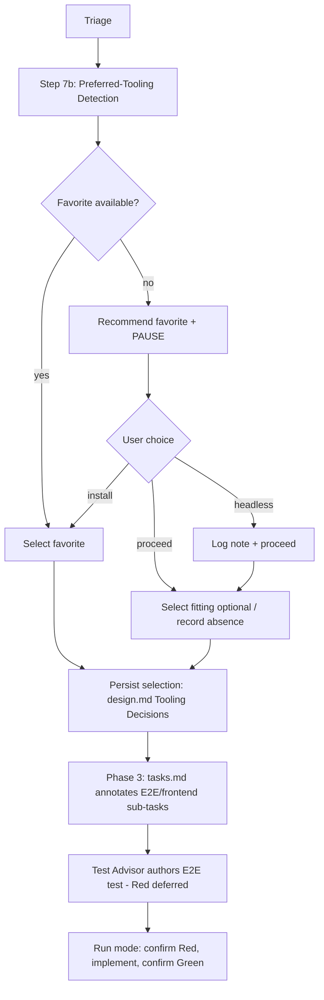

# Design - Preferred Tooling Policy

## Overview

The feature introduces a single policy document, `references/preferred-tooling.md`,
modeled on the existing `references/mcp-integration.md`. It defines the favorite
and optional tool tiers, a three-mechanism detection procedure, and a
recommend-and-pause fallback. Triage gains a detection step that resolves tool
selections and writes them into `design.md` and `tasks.md`; Phase 3 extends the
Test Advisor to author E2E tests, deferring their Red verification to Run mode.
The Epic plugin is documentation-driven — "implementation" means editing
reference docs, agent definitions, and `SKILL.md`; no new executable code is
required.

## Architecture



## Components & Interfaces

### C1. `references/preferred-tooling.md` (new)

- **Responsibility:** Single source of truth for the tooling policy — tier
  lists, detection procedure, fallback rules.
- **Interface:** Consumed (read/loaded) by `SKILL.md` triage, the Test Advisor,
  and the Executor. Structure mirrors `mcp-integration.md`: `# Title` → intro →
  `## Priority order` (table) → `### Hard rules` → `## Detection procedure` →
  `## No favorite available` → `## Rules`.
- **Dependencies:** None — it is the root of the policy.

### C2. `SKILL.md` — triage detection wiring

- **Responsibility:** Run detection during triage, surface results, persist the
  decision.
- **Interface:** New triage **step 7b "Detect preferred tooling"** after step 7
  (MCP health-check); new `### Preferred Tooling` subsection beside `### MCP
  Integration`; new `> - Tooling:` line in the triage proposal block listing
  detected tools, resolved selection, and any favorite-absent recommendation.
- **Dependencies:** C1; the Runtime dependency precheck's interactive/headless
  signal (for R3.4).

### C3. `agents/test-advisor.md` — E2E authorship

- **Responsibility:** Author E2E test files in Phase 3 (in addition to
  Unit/Integration), using the story's selected E2E tool, deferring Red.
- **Interface:** Inputs gain "selected E2E tool"; the E2E exclusion rule
  (line ~120) is replaced; a new deferred-Red rule writes a `red_deferred: true`
  entry to `red-evidence.yaml` instead of `failed: true`.
- **Dependencies:** C1 (tool), `tasks.md` Tests field, design.md contract.

### C4. `references/run-mode.md` — deferred Red for E2E

- **Responsibility:** For an E2E sub-task carrying a pre-authored test with
  `red_deferred: true`, the orchestrator confirms Red at run time **before**
  spawning the Executor, then confirms Green after.
- **Interface:** New clause in the materialization / Task Execution Flow; the
  Executor's `test-first` step 2/5 branching is unchanged.
- **Dependencies:** C3 (`red_deferred` schema field).

### C5. Consistency edits (E2E-exclusion sites)

- **Responsibility:** Keep the "what the Test Advisor authors" rule identical
  across all three sites that currently exclude E2E.
- **Interface:** `agents/test-advisor.md` (~lines 21, 24, 114, 120-121),
  `references/phase-gates.md` (~lines 158, 175, 183-185), `references/tasks.md`
  (~line 121) all change in one pass to the same wording.
- **Dependencies:** C3.

### C6. `references/design-guide.md` + `agents/executor.md`

- **Responsibility:** `design-guide.md` Testing Strategy template gains a tool
  annotation and a "Tooling Decisions" block (R6.1); `executor.md` gains a note
  that frontend sub-tasks use `frontend-design` when designated (R5.2) and that
  an E2E sub-task may carry a not-yet-Red pre-authored test.
- **Dependencies:** C1.

### C7. Release-sync docs

- **Responsibility:** `CHANGELOG.md`, `README.md`, `ARCHITECTURE.md` reflect the
  new reference doc and the extended Test Advisor scope.
- **Dependencies:** All of the above.

## Data Models

### Tool priority table (`preferred-tooling.md`)

| # | Tool | Tier | Kind | When to pick |
|---|---|---|---|---|
| 1 | `playwright` | Favorite | MCP | Default favorite for any E2E need |
| 2 | `chrome-devtools` | Favorite | MCP | Favorite when the task is Chrome-specific (perf, DevTools traces) |
| 3 | `puppeteer` | Optional | Library/CLI | Already installed; Chrome/Chromium scripting without a favorite |
| 4 | `selenium` | Optional | Library/CLI | Already installed; legacy or multi-browser grid context |
| 5 | `browser-use` | Optional | MCP | Already installed; AI-driven, exploratory interaction |
| 6 | `stagehand` | Optional | MCP | Already installed; AI-driven structured extraction |

`frontend-design` is a Claude Code **skill** (not in the E2E table) — favorite
implementation aid for frontend stories.

The `# When to pick` column is the **context** rule; the `#` column is only a
last-resort tie-break when context does not disambiguate.

### `red-evidence.yaml` — extended schema

```yaml
red-evidence:
  - task: "2.1"                       # Unit/Integration — unchanged
    test_file: ".draft/authored-tests/tests/foo.test.ts"
    target_path: "tests/foo.test.ts"
    command: "npm test -- foo"
    failed: true
    reason: "ReferenceError: validateEmail is not defined"
    recorded: 2026-05-17
  - task: "4.2"                       # E2E — new shape
    test_file: ".draft/authored-tests/e2e/checkout.spec.ts"
    target_path: "e2e/checkout.spec.ts"
    tool: "playwright"
    red_deferred: true                # NEW — Red confirmed in Run mode, not Phase 3
    recorded: 2026-05-17
```

`failed`/`reason`/`command` are **absent** for an E2E entry (no run happened).
`red_deferred: true` and `failed: false` are mutually exclusive — `failed: false`
still means a broken test that blocks Phase 3.

### design.md "Tooling Decisions" block (written by triage)

```markdown
## Tooling Decisions

- E2E tool: `playwright` (favorite, MCP available) | none — no E2E tooling available
- Frontend aid: `frontend-design` (skill available) | none
- Recommendation surfaced: <yes — favorite absent, user proceeded | no>
```

When triage resolves no favorite and no fitting optional E2E tool, the `E2E tool`
line records `none — no E2E tooling available` and the same phrase is added to
the story's Constraints — this is the persisted form of the story.md assumption.

### tasks.md E2E/frontend sub-task annotation

- E2E sub-task Tests field: `` E2E · `playwright` · `e2e/path.spec.ts` — scenarios ``
- Frontend sub-task ToDo gains: "use the `frontend-design` skill" when designated.

## Detection Procedure

Run in triage, **all modes including Fast** (cheap, and selection annotations
matter for E2E sub-tasks).

1. **MCP tools** (`playwright`, `chrome-devtools`, `browser-use`, `stagehand`):
   verify via a minimal health-check call (same pattern as `mcp-integration.md`).
2. **Library/CLI tools** (`puppeteer`, `selenium`): inspect the dependency
   manifest (`package.json`, lockfiles, `requirements.txt`, etc.) first. WHERE
   the manifest is inconclusive, run a single version-probe command
   (`npx <tool> --version` or equivalent).
3. **Skill** (`frontend-design`): check presence in the session's
   available-skills list.
4. WHERE a mechanism cannot run (no manifest, skill list unavailable), mark the
   tool **undetermined** — never assume installed.

## Error Handling Strategy

- **Detection mechanism unavailable:** mark tool `undetermined`, proceed (R2.6).
- **Favorite absent, interactive session:** recommend + PAUSE for install/proceed.
- **Favorite absent, headless session:** emit a logged recommendation note,
  proceed without pausing (R3.4) — never call `AskUserQuestion` in headless.
- **No favorite and no fitting optional tool:** record "no E2E tooling
  available" as a story constraint and proceed without E2E tool guidance.
- **Multiple optional tools fit:** select by the `When to pick` context; if
  still tied, use the table `#` order; record a one-line justification.

## Testing Strategy

This feature edits markdown specs and agent prompts — there is no new
executable logic, so unit/integration coverage is limited to the plugin's
existing validation tooling.

- **Unit tests:** none — no functions added. (Test Advisor will mostly return
  `None`/`Acceptance` for documentation sub-tasks.)
- **Integration tests:** `scripts/validate-story.sh` and `scripts/cross-reference.sh`
  pass on this story; `bats tests/` and `shellcheck` show no regression.
- **E2E tests:** not applicable — the feature ships no runnable UI or service.
- **Consistency check:** the three E2E-exclusion sites (C5) must read
  identically after the change — verified by Grep, not an automated test.

## Integration Points

- **Triage (`SKILL.md`):** step 7b runs detection; proposal block reports it.
- **Phase 3 (`phase-gates.md` + `test-advisor.md`):** Test Advisor authors E2E
  tests with deferred Red.
- **Run mode (`run-mode.md`):** orchestrator confirms deferred Red for E2E
  sub-tasks before the Executor runs.
- **Executor (`executor.md`):** consumes the `frontend-design` designation and
  the persisted E2E tool; its 6-step protocol is otherwise unchanged.
