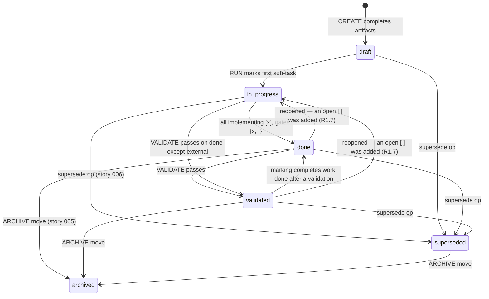

# Design - Story State Machine & Checkbox Grammar

## Overview

Two coupled grammar extensions that form the data model every other wave-1 story builds on: a **persisted `status:` enum** in artifact frontmatter, written exclusively by the engine at fixed transition points, and a **third checkbox state `[~]`** with a structured qualifier for work that is resolved without being executed. The field-study of 26 real projects showed both were already invented organically (8 divergent `status:` dialects; `[~]`/`N/A`/`DEFERRED` improvisations in 7 projects) — this design canonizes the proven shape and makes the engine, not the human, the writer.

Two governing principles, both evidence-driven:
1. **Engine-written, never hand-edited.** The one project that hand-maintained `status:` produced values that lie (6 stories `draft` with 100% checkboxes). Every transition below is written by the orchestrator; humans editing `status:` is tolerated but flagged by validation.
2. **Legacy-tolerant.** 340+ existing stories across 26 projects have no `status:` field. Absence is NEVER an error — at most an informational note. `hook-task-completed.sh` now blocks with exit 2; a strict check here would brick sessions in every legacy project.

## Architecture

Persisted enum (6 values): `draft | in-progress | done | validated | superseded | archived`.

Computed conditions (displayed by LIST/validate, **never persisted**):
- `done-except-external` — no `[ ]` remaining, but ≥1 `[~] (deferred: …)` present.
- `integrated` — git evidence of merge to main (story 006; evaluated live, never stored).

(A `blocked` computed condition was considered and deferred out of this story's scope — no acceptance criterion covers it; future work.)

Companion field: `superseded-by: MMM` — written ONLY by the supersede operation (story 006) next to `status: superseded`; the machine-readable source for index rendering (story 005).

## Components & Interfaces

### 1. Frontmatter `status:` field

- **Responsibility:** single persisted lifecycle state per story, shared by all artifacts of the story (same value in story.md/design.md/tasks.md frontmatter, mirroring the existing `version` rule).
- **Writers (exhaustive):**
  | Transition | Written by | Point |
  |---|---|---|
  | → `draft` | CREATE mode | when final artifacts are written (SKILL.md Output Rules — new stories only) |
  | → `in-progress` | RUN mode | when the first sub-task is marked (run-mode.md step that writes `[x]`) |
  | → `in-progress` (reopen) | RUN mode, REFINE mode | when a census finds an open `[ ]` on a story reading `done` or `validated` (R1.7). REFINE writes the field for **this transition only** (R1.8) and never any other value — adding open work is the one thing a refinement observes about lifecycle state |
  | → `done` | RUN mode | when completion condition is met after marking a sub-task |
  | → `validated` | VALIDATE mode | on Validator+Auditor pass (validate-mode.md final step) |
  | → `superseded` | supersede op | story 006 |
  | → `archived` | archive op | story 005 (manifest also records it) |
- **Write mechanism:** orchestrator `Edit` on the frontmatter line (GOTCHA: `Edit` deliberately — the `hook-validate` PostToolUse matcher is `Write` only (hooks/hooks.json:5), so engine writes do not re-trigger validation storms).
- **Interface for readers:** `validate-story.sh` and `list-mode.md` read it; `fm_get`-style sed/grep parsing consistent with existing frontmatter reads (validate-story.sh:194-211).

### 2. Checkbox grammar `[~]`

- **Syntax:** `- [~] N.N - Title (qualifier: reason)` — qualifier is MANDATORY, same line, one of:
  | Qualifier | Meaning | Terminal? |
  |---|---|---|
  | `deferred: <reason>` | resolved in plan, execution awaits external actor (hardware, operator, live proof) | no — story becomes `done-except-external` |
  | `waived: <reason>` | gate consciously dispensed (tool absent, user decision) | yes |
  | `n-a: <reason>` | not applicable by construction | yes |
  | `superseded-by: NNN` | this sub-task's scope moved to story NNN | yes |
- **Completion semantics (the new single definition):** a story is complete when **no `[ ]` remains**; it is `done` when every box is `[x]` or terminal `[~]`; it is `done-except-external` when the only non-`[x]` boxes are `[~] (deferred: …)`. Implementing sub-tasks and Quality Gates use the same grammar — no per-line-type distinction (evidence: the corpus used `[~]` on both).
- **Counting semantics:** `total = [ x~]-boxes` · `closed = [x] + terminal [~]` · `deferred = [~] deferred` · progress rendered as `closed/total (+D deferred)`.

### 3. Atomic parser update (the quadruplication)

The checkbox regex is duplicated across **six scripts** — the update MUST land in all of them in one change-set, with cross-regression tests, or the exact false-clean/false-orphan class fixed by e890d02 reopens.

> **Corrected twice, and the second correction is the lesson.** v1 of this section said "6 places across 4 scripts" and omitted `scripts/hook-precompact.sh`; sub-task 5.3 raised it to "7 places across 5 scripts" and left the omission of `scripts/hook-post-tool-failure.sh`, found by the second validate-mode pass. Two independent enumerations of the same list, both wrong, is not bad luck — it is the shape of the artifact. So this table no longer carries a place-count or line numbers: **it addresses code by stable anchor** (variable or matcher name), and the authority on completeness is `tests/checkbox-grammar.bats`, which fails when a consumer disagrees, rather than a prose list that cannot.

| File | Anchor | Change |
|---|---|---|
| `scripts/validate-story.sh` | `OLD_FORMAT_COUNT`, `box_re` / `terminal_re`, the census loop feeding `BOX_OPEN` / `BOX_CLOSED` / `BOX_UNQUALIFIED`, `TASK_COUNT` | `\[[ x]\]` → `\[[ x~]\]` where counting totals; a qualified `[~]` closes a box whatever its qualifier — this script does **not** split terminal from deferred (Task 6.5: no consumer here, and R5.1 forbids adding one) |
| `scripts/cross-reference.sh` | `task_heading_re` | accept `[~]` headings so their `Requirements:` lines keep attributing (a deferred sub-task still traces) |
| `scripts/hook-task-completed.sh` | the phase-3 detection matcher | phase-3 detection regex includes `[~]` |
| `scripts/monitor-stale.sh` | the pending matcher | pending = `[ ]` only (a `[~]` story is not stale-pending) |
| `scripts/hook-precompact.sh` | the census loop feeding `TOTAL` / `DONE` / `DEFERRED` | total counts `[ x~]`; done = `[x]` + terminal `[~]`; `(+N deferred)` suffix. **The one script where the terminal/deferred split is observable** — it renders it. Task 6.5 replaced its `grep \| grep -cv` pipeline (a second implementation of the qualifier rule, already disagreeing with validate-story on `- [~]waived: …`) with the shared loop |
| `scripts/hook-post-tool-failure.sh` | the mid-run guard (`has_closed_box` / `[ ]`-present) and `NEXT` | closed = `[x]` + terminal `[~]`, via the same census loop (Task 6.4). Before it, a story whose closed boxes were all `[~]` read as "not mid-run" and the executor Step-4 reminder was silently suppressed — the quietest failure in the set, since a swallowed reminder looks exactly like no failure |

**What R4.1 actually proves, and what it cannot** (sub-task 5.6). R4.1 asks that the tools "report mutually consistent totals"; R5.1 forbids changing legacy output byte-for-byte. Those pull against each other: `validate-story.sh` therefore emits **no** count key — adding one would break every legacy golden — so the harness cannot compare numeric triples across all six. What it does compare is stronger than nothing and weaker than the criterion's literal wording: cross-reference exposes `parseable_tasks`, hook-precompact exposes a rendered `closed/total (+D deferred)` line, and the two hooks and the monitor expose only exit codes and injected text, so their agreement is asserted **behaviorally** — the same fixture must make each tool act as though it sees the same boxes. A drifted regex changes at least one of those observable behaviors, which is what the mutation check confirms. Resolution: R5.1 wins on output shape, R4.1 is satisfied behaviorally, and this paragraph exists so the next reader does not "fix" it by adding a count key.

**Why the duplication remains.** The real structural fix is a shared census helper sourced by all six scripts. It is deliberately **not** done here: the hooks are standalone entry points invoked by Claude Code, and introducing a sourced library across six of them is its own story, not a line item in a remediation task. What Task 6 did instead is make the copies *identical in shape* — one parse loop with token-anchored qualifiers in validate-story, hook-precompact and hook-post-tool-failure — so a divergence is a visible edit rather than a subtle regex difference. The drift risk is held down by the cross-regression harness — verified by mutation, not by assertion.

GOTCHA (deployment order inside the task plan): validators learn `[~]` **before** any engine path writes it — `hook-task-completed.sh` blocks with exit 2 and would otherwise reject the engine's own write.
GOTCHA (bash 5.3): any new assoc-array counting uses manual counters (`REQ_KEYS` pattern, cross-reference.sh:98) — `${#assoc[@]}` on an empty assoc array trips `set -u`.

### 4. Validation additions (`validate-story.sh`)

- `status:` present but not in enum → **error** (catches hand-invented dialects).
- `status:` absent → **nothing** (legacy tolerance; no warning — 340+ stories would light up).
- `status:` inconsistent across the story's artifacts → warning.
- `[~]` without a recognized qualifier on the same line → **error** with the 4 valid forms listed.
- `status: done|validated` while `[ ]` boxes remain → warning "status ahead of checkboxes" (the pmg lie, now visible).

### 5. LIST rendering (`references/list-mode.md`)

- Status column: persisted enum value; annotate computed conditions: `done · não-integrada` (006), `done-except-external (2 deferred)`, `blocked`.
- Progress: `closed/total` per the new counting semantics (a `[~] waived` gate no longer renders a story eternally partial — the corpus's #1 false signal).

## Error Handling Strategy

- Engine write fails (Edit conflict): report, continue — `status:` is advisory metadata, never blocks the run itself.
- Legacy story mid-RUN (no `status:`): engine adds the field on first transition it performs; never retro-writes states it didn't observe.
- Unknown future qualifier: validation error names the line and the 4 valid forms (fail-closed on grammar, fail-open on absence).

## Testing Strategy

- **Unit (bats):** per-script regression suites — `[~]` parsing in the scripts that parse it; qualifier validation (each valid form + missing + unknown); enum validation (valid/invalid/absent); counting semantics (total/closed/deferred) on fixtures mixing `[x]`/`[ ]`/`[~]` terminal/deferred, including the spaceless `- [~]waived:` shape that once split the two census implementations.
- **Cross-regression (the atomicity guard):** ONE shared fixture story passed through all **six** consumers, asserting they act as though they see the same boxes — pins the duplication so a future seventh copy can't drift silently.
- **Integration:** fixture legacy story (no status, no `[~]`) passes unchanged through the consumers that emit output (byte-identical JSON vs pre-change output) — the compat contract as a test.
- **E2E:** none (tool: none — CLI/markdown plugin; harness is bats + shellcheck).

## Tooling Decisions

- E2E tool: none — no E2E tooling applicable (shell/markdown plugin; test harness: bats via local checkout + shellcheck)
- Frontend aid: none
- Recommendation surfaced: no — domain not applicable

## Integration Points

- **Story 005 (archive)** consumes: completion definition (`done`/`done-except-external` gates the offer), `status: archived` transition, counting semantics for the derived manifest.
- **Story 006 (git-aware)** consumes: `superseded` state, `superseded-by: NNN` qualifier.
- **References to update:** `references/tasks.md` (grammar section — the `[~]` table above verbatim), `references/run-mode.md` (:112 marking step + transitions), `references/validate-mode.md` (:77 completion def + validated transition), `references/list-mode.md` (:9 progress, :74 archive gate), `skills/epic/SKILL.md` (frontmatter spec :455-482, completion definition).
- **Release engineering (whole wave):** version bump to 0.4.0 synchronized in `.claude-plugin/plugin.json`, `.claude-plugin/marketplace.json`, `README.md`, `CHANGELOG.md`, `ARCHITECTURE.md`; marketplace installs a cached copy — local testing goes through `bin/epic-validate`/`bin/epic-xref` and the bats suite, not the installed plugin.
