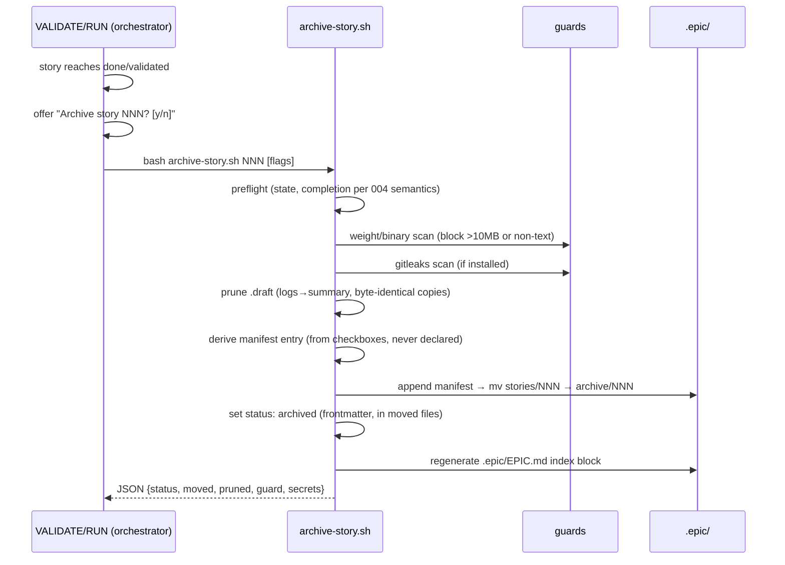

# Design - Archive in the Flow

## Overview

Archive today is prose (`references/list-mode.md:52-89`): a manual `mv` plus a hand-declared manifest — which produced the corpus's worst lifecycle data (archive absent in 20/26 projects; one mass-sweep of 71 stories stamped `complete-merged-to-master` including stories with 0/14 tasks; 55 MB of test logs and one 2.3 GB binary archived wholesale). This design makes archive an **in-flow, scripted, guarded operation**: a single new CLI (`scripts/archive-story.sh`) performs preflight → guards → prune → derived manifest → move → index regeneration, and the orchestrator **offers** it at the moment the corpus proved it happens organically — right after a passing validate.

Key architectural decision: **the whole file operation lives in one Bash script.** `hook-archive-guard.sh` (PreToolUse, hooks.json:21-28) blocks `Edit|Write` inside `.epic/archive/**` — by design it cannot see Bash file operations, so the script is the sanctioned bypass while the guard keeps protecting interactive edits. The guard's refusal message is updated to point at the script.

## Architecture

## Components & Interfaces

### 1. `scripts/archive-story.sh` (new)

- **Interface:** `archive-story.sh <NNN|story-dir> [--allow-heavy] [--skip-secrets] [--keep-logs] [--keep-copies] [--force]`
- **Output:** JSON on stdout — `{story, status: archived|blocked|refused, moved: bool, pruned: {logs_kb, copies_removed}, guard: {violations: []}, secrets: {findings: N}, index: ok|regen-failed, manifest_entry: {...}}`. Fail-closed: any guard hit → `blocked`, exit 1, nothing moved; `refused` → exit 1. Exit 0 only on completed move. Exit 2 invalid input. `--force` REQUIRES a reason argument (`--force <reason>`). `json_escape()` on every string (convention from e890d02).
- **Steps (order is load-bearing — nothing destructive before all guards pass):**
  1. **Preflight:** resolve story dir (stories/ only; already archived → refuse). Completion check per 004 semantics: state `done`/`validated`/`superseded` or no-`[ ]`-remaining; otherwise refuse unless `--force <reason>` (reason recorded in manifest — kills the silent mass-sweep-with-false-stamp).
  2. **Weight/binary guard (default-on):** any file >10 MB or non-text (heuristic: `LC_ALL=C grep -qI .` per file; NUL-containing = binary) → `blocked` listing offenders. Override `--allow-heavy` (recorded in manifest). Would have caught zeo's 2.3 GB binary and the 104 PNGs.
  3. **Secrets guard (default-on when available):** `command -v gitleaks` → `gitleaks dir <story> --no-banner --exit-code 1 --max-target-megabytes 15`; findings → `blocked` with count + report path. Absent gitleaks → informational note, proceed. Override `--skip-secrets` (recorded).
  4. **Prune (default-on, after guards):** `.draft/logs/*` → single `\.draft/logs-summary.md` (file list + sizes + last-modified + tail of the most recent log; evidence: 55 MB in 2 pmg stories); `.draft/` files byte-identical (`cmp -s`) to their promoted sibling → deleted (evidence: 4+ stories with exact copies). Overrides `--keep-logs`, `--keep-copies`.
  5. **Manifest:** append to `.epic/archive/manifest.yaml` — entry **derived, never declared**: `story, number, slug, type, scale, status (frontmatter), tasks_total, tasks_closed, tasks_deferred (counted by the same grammar as 004), deferred_items [] (one "N.N — title (reason)" line per deferred box — R4.4 records the items, not just the count), archived_at, pruned {…}, overrides_used []`. Created with header + policy line (`# Numbers are never recycled`) when absent. Written by THIS script via Bash (guard-exempt by design).
  6. **Move:** `git mv` when the paths are tracked (preserves history — the wakeru gold standard), plain `mv` otherwise.
  7. **Status:** set `status: archived` in the moved artifacts' frontmatter (sed in-place — Bash, post-move, guard-exempt).
  8. **Index regeneration** (component 3) — failure here warns but does not roll back the move.

### 2. In-flow offer (orchestrator)

- **Point:** end of VALIDATE on pass (`references/validate-mode.md:80-81`) and end of RUN when the story transitions to `done` (`references/run-mode.md:465-466`) — same `[y/n]` pattern as the existing "Run Validator?" offer. Evidence: the only organic archive in 26 projects happened exactly there (clubedavoz 028, colado ao validate).
- `done-except-external`: offer includes the deferred list — archiving with pendências is allowed and they land in the manifest entry.
- Headless/CI: no pause; log the suggestion (mirrors preferred-tooling headless rule).
- ARCHIVE mode (`stories archive NNN[-MMM]|--done`) delegates to the script per story — prose procedure in list-mode.md replaced by the script contract.

### 3. Managed index (`.epic/EPIC.md`)

- **Decision: regeneration, not link-rewriting.** A generated block between `<!-- epic:index:start -->` / `<!-- epic:index:end -->` markers; content outside the markers is preserved (projects already hand-write context there). Regenerating from disk state makes links correct by construction — no sed surgery on hand-maintained files (the clubedavoz frozen-index failure mode).
- **Generator:** `scripts/epic-index.sh` (new, small): scans `stories/` + `archive/` + manifest → table per story: number, slug, `status` (frontmatter or "—" legacy), progress (004 counting), area (active/archived — links resolve accordingly); `status: superseded` rows read the frontmatter companion `superseded-by: MMM` (004/006) and render `superseded by MMM` — or `superseded by MMM (missing)` when MMM resolves nowhere; `scale: spike` rows render the Verdict status (007). Idempotent; stable ordering by number.
- **Invocation:** archive-story.sh step 8; CREATE/RUN/VALIDATE completion; `stories` LIST refreshes it opportunistically. File absent → created with markers only when the project has ≥1 story (no noise in empty repos).

## Error Handling Strategy

- Guard violations: exit 1, JSON `violations[]` with per-file reason — orchestrator surfaces verbatim; nothing was moved.
- Move succeeded, index regen failed: warn + manifest already correct; next LIST retries regeneration (idempotent).
- Manifest append fails (permissions): abort BEFORE mv (step order) — never a moved story without a manifest entry.
- Story with no tasks.md (seed): refuse with pointer to supersede (006) or `--force`.

## Testing Strategy

- **Unit (bats):** guard triggers (10 MB boundary file, NUL-binary, clean); prune (log dir → summary contents; byte-identical vs differing `.draft` copy); manifest derivation (counts match a fixture with `[x]`/`[ ]`/`[~]` mix — asserts derived-not-declared); preflight refusals (incomplete story, already archived, `--force` records reason); flags (`--allow-heavy` etc. recorded in `overrides_used`); JSON validity via `jq -e` on every path. Secrets guard tested with a gitleaks-detectable fixture pattern (fake AWS-style key) gated on `command -v gitleaks` (skip-with-note otherwise).
- **Integration (bats):** full run on a temp git repo — tracked story → `git mv` path preserves history (`git log --follow` non-empty); untracked → plain mv; index block regenerated with archive/ link; re-run on same story → `refused`, idempotent.
- **E2E:** none (tool: none).

## Tooling Decisions

- E2E tool: none — no E2E tooling applicable (bats + shellcheck harness)
- Frontend aid: none
- Recommendation surfaced: no

## Integration Points

- **Depends on 004:** completion semantics (`done`/`done-except-external`, `[~]` counting) and the `status: archived` transition.
- **hook-archive-guard.sh:** message updated to point to `archive-story.sh`; guard behavior unchanged (still blocks interactive Edit/Write).
- **references:** list-mode.md archive section rewritten around the script contract; validate-mode.md + run-mode.md gain the offer step; SKILL.md ARCHIVE routing points to the script.
- **Story 006:** supersede's immediate-archive offer calls this same script.
- **bin/:** optional thin wrapper `bin/epic-archive` following the existing `bin/epic-validate` pattern.
