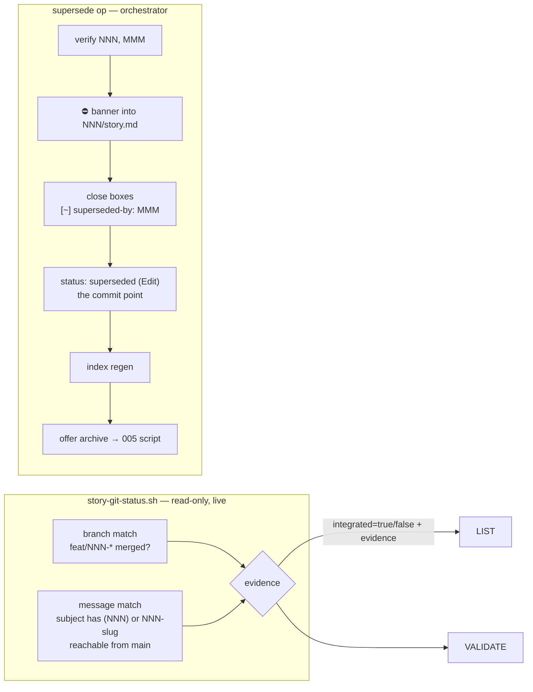

# Design - Git-Aware Lifecycle

## Overview

Two lifecycle capabilities driven by external evidence. First, an **`integrated` computed flag**: the corpus proved "complete" and "merged to main" are independent axes the plugin cannot see (bleach v0 died with 21/21 stories checkbox-complete and zero merges; thiago 014-017 complete with the branch 18 commits ahead of master) — LIST and validate gain a live, non-blocking warning. Second, **supersede as a first-class operation** (`stories supersede NNN --by MMM`): the corpus invented it by hand (⛔ banners, `status: superseded`, remap notes in pmg/avfarma) because replacing a story has no sanctioned path.

Governing principle (evidence: recorded SHAs died in 100% of tested cases — purge, squash, org migration — while names/messages survived everything): **evaluate git live, store nothing.** No SHA, no branch name, no merge-base is ever written into artifacts.

## Architecture



## Components & Interfaces

### 1. `scripts/story-git-status.sh` (new, read-only)

- **Interface:** `story-git-status.sh <NNN|story-dir>` → JSON `{story, main_branch, integrated: bool, evidence: [{kind: branch-merged|message-ref, detail}], checked_at}`. Exit 0 always when computable; exit 2 when not a git repo / story not found (callers degrade silently — a non-git workspace is legal, ti-001 case).
- **Main detection (R1.5, R1.11, R1.12) — the NAME and the REVISION are two different answers:** `git symbolic-ref refs/remotes/origin/HEAD` → strip the literal prefix `refs/remotes/origin/`; fallback: local `main`, then `master`; none → `{integrated: null}` (unknowable, callers stay quiet). **`--short` is forbidden here (R1.12)**, and the reason is this story's own recorded discovery: git's short spelling is *ambiguity-aware*, so it is not a function of the ref alone — it moves under refs this run never looked at. The team wrote that down at group 6 (`deviations.yaml`, the `discoveries:` entry for task 6.1 on `%(refname:short)`) and applied it to the branch enumeration, which switched to `%(refname)`; main resolution was the one call site the lesson never reached, and it was the only remaining ambiguity-aware call in the file. A single ref named `origin/<default>` — a branch or a tag, both reachable through porcelain — makes git answer `remotes/origin/main`, the fixed `origin/` strip misses, and the corrupted string becomes both the reported name AND the revision probed. That is not cosmetic: it is the only defect found in five reviews that changes `integrated` itself, the one field both consumers branch on. Stripping a literal full-path prefix is deterministic and needs no extra git call. That resolution yields the **name** reported as `main_branch`. The **revision** the evidence queries actually run against is the *local* branch carrying that name when it exists, falling back to the remote-tracking ref — so an unpushed local merge counts as integration (R1.11), which is the intended reading in a local-first workflow. That revision is spelled as a FULL refname (`refs/heads/<name>` or `refs/remotes/origin/<name>`), never the bare name: a bare `main` in a repository that also holds a tag `main` is the same ambiguity one layer down, and a full refname closes it for the same cost. The consequence is worth stating plainly rather than leaving it to be rediscovered: a story whose work reached only the developer's local `main` reports `integrated: true` while the shared default branch does not contain it. Deliberate, decided at the fourth validate; the alternative (query the remote-tracking ref always) was rejected because it reports legitimate unpushed work as un-integrated.
- **Evidence rules (either suffices; both reported):**
  1. *branch-merged:* any branch matching `feat/NNN-*` or `*/NNN-<slug>*` (slug from the story dir) fully merged into main (`git branch -a --merged <main>`).
  2. *message-ref:* ≥1 commit reachable from main whose subject matches `\(NNN\)` (conventional `type(NNN):`) or contains `NNN-<slug>`. GOTCHA (Architect): `feat/NNN-slug` is an emergent corpus convention documented nowhere in the plugin — detection MUST accept branch OR message; this design also adds the convention to `references/tasks.md` commit guidance (making the anchor canonical is wave-3 3.1; here it becomes documented-recommended).
- **Evidence uniqueness (R1.8):** one merged branch yields exactly one `branch-merged` entry, however many refs point at it. The duplicate is not one rule firing twice — `feat/NNN-slug` matches the anchored `^feat/0*NNN-` pattern while `origin/feat/NNN-slug` matches only the `/0*NNN-<slug>` pattern, so the pair arrives through *different* rules and no guard inside either match can see it. Deduplication therefore runs over the accumulated evidence list, keyed on ref identity (remotes read from `git remote`, never a hardcoded `origin` — a remote name may itself contain a `/`). Three rules govern it, and every implementation so far got one of them wrong in a way its own tests could not see:
  1. **Identity comes from the full refname, not the short one — and a shared name is not a shared branch (R1.9).** Enumerate with `%(refname)`: `refs/heads/x` and `refs/remotes/<r>/x` are the *candidate* pair to collapse, while a *local* branch literally named `origin/x` in a repo that does have an `origin` remote is a different branch and must survive as its own entry. `%(refname:short)` renders both as `origin/x` and cannot tell them apart. But the refname is only half the predicate, and v4 shipped only that half: matching names is **necessary and not sufficient**. `refs/remotes/<r>/x` collapses into `refs/heads/x` only when it is genuinely that branch's mirror — when `<r>/x` is `x`'s configured upstream (`branch.x.remote`), or the two point at the same commit. Same-object alone is too strict (a local branch legitimately ahead of its remote-tracking ref would split in two, re-breaking R1.8); name alone is too loose, and that looseness is exactly what makes `fork/x` at a different tip vanish into `refs/heads/x`.

     **The split itself can be ambiguous, and guessing it loses branches (R1.13).** Deciding *which* remote a `refs/remotes/...` ref belongs to is not simply "the first path segment", and v5 handled that by taking the first configured remote whose name is a prefix and stopping — with a comment asserting the guess is harmless because "the collapse needs BOTH predicates … at worst one extra evidence entry, never a missing one". Measured at the fifth validate, that is false: with remotes `a` and `a/b`, `refs/remotes/a/b/feat/NNN-x` is read as branch `b/feat/NNN-x` of remote `a`, whose local counterpart may well exist, be merged and sit at the same object — both predicates hold, the collapse fires, and branch `feat/NNN-x` of remote `a/b` disappears. So the rule is not a better guess but no guess: **when more than one configured remote name is a prefix, the ref keeps its own identity.** That direction is provably safe — refusing a collapse can only ever add an entry — and it is what makes the "never a missing one" claim true instead of merely asserted. `git remote add` refuses such a pair in either order, so the topology only arrives from a hand-written config; the rule costs one comparison and removes the class.
  2. **The reported detail must name a ref that is itself merged.** Preferring the local short name is safe only when that local branch is in the merged set. A local `feat/NNN-x` that diverged and never merged must not be named as branch-merged evidence merely because its remote-tracking counterpart was. Existence is the wrong predicate; membership in the merged set is the right one.
  3. **Two surviving identities must be distinguishable in the emitted document (R1.10) — and the predicate is the RENDERED detail, not the short name.** Rule 1 computes identity from the full refname and the detail is then rendered as the short name, which throws that distinction away again: `refs/heads/origin/x` and `refs/remotes/origin/x` both render `origin/x`, so the document carries two byte-identical entries and a consumer counting distinct details reads one. Disambiguate the way git itself does — `heads/origin/x` versus `remotes/origin/x`. **v5 chose the wrong set to ask the question of**, and the fifth validate measured the consequence: it escalated a pair whose *short names* collided, then emitted the longer spelling without asking whether *that* spelling was free. Add a third branch literally named `remotes/origin/feat/NNN-x` and the qualified detail of the escalated pair is byte-identical to the plain detail of a branch that had no collision at all — three entries, two distinct details. So the rule is stated over the output: render every surviving identity, and while any two rendered details are equal, escalate the colliding ones to the next spelling (short → qualified → full refname). Termination is free — refnames are unique by construction, so the escalation has a fixed point. R1.10 constrains what the document says; a predicate over anything but the document is a predicate over the wrong thing.

  `integrated` is unaffected by any of the three — the rule is existential — but a consumer that counts or renders `evidence[]` would double-count one piece of work, silently drop another, or read a branch name that never reached main.

  **The governing lesson, since four consecutive validates found a defect here.** R1.8 (never report one branch twice) and R1.9 (never report two branches once) are converses, and each implementation so far satisfied one by violating the other: v3 deduplicated on the short name and collapsed distinct branches; v4 fixed identity but kept the name-only predicate, so `fork/x` at a different tip still vanished. A test written from the code asks "what does this do?" and passes; only a test written from the requirement asks "what does this forbid?" **Every rule in this section therefore ships with the case that violates it, authored first** — see tasks.md 7.1.

  **And the fifth validate found the limit of that rule as written.** v5 obeyed it: 7.2 and 7.3 each authored the hostile half first, and both are honest tests of the requirement they came from. The defect landed anyway, because the rule was applied to the *requirement being corrected* and not to the *derived value the correction introduced*. Rule 3's escalated spelling is a new string this design invented; nothing in the suite ever asked what would make THAT string collide. The rule therefore extends: when a fix introduces a derived value, the hostile-half question is asked of the derived value too, and "can a third element collide?" is the first form of it — a uniqueness check written over pairs is the recurring shape of the bug here. See tasks.md 8.1.
- **Anti-noise:** NNN matched with zero-padded and unpadded forms but ONLY as a delimited token — bare `4` never matches (regex `\b0*NNN\b` guarded by `(`/`)`/`/`/`-` context). Detached HEAD / shallow clone: evaluate what is visible; never fail.
- **JSON safety (R1.7):** `evidence[].detail` carries a commit subject — the rawest externally-authored string the plugin ever handles. Control characters are legal in a commit message and RFC 8259 forbids them raw inside a JSON string, so `json_escape()` MUST use the full `\uXXXX` C0/C1 table already proven in `scripts/archive-story.sh`'s `_json_escape_table` (`:150-170`), not the lighter `validate-story.sh` variant (which covers only `\ " \n \r \t`). A single raw `0x0C` in a matching subject makes the whole document unparseable while the script still exits 0 — and that is an *undefined* caller path, because R1.4's degrade-silently contract only covers exit 2. The producer stays dependency-free: consumers parse with jq, the emitter must never need it.

### 2. LIST + validate surfacing (non-blocking, per user decision)

- LIST: stories with state `done|validated` get an annotation — `integrada` / `não-integrada` / (nothing when null). Computed per story via component 1; skipped when >50 stories unless `stories full` (cost control: one git call per done-story).
- validate-mode: on pass, when `integrated=false`, append warning `story is done but no evidence of integration to <main> (no merged feat/NNN-* branch, no (NNN) commit)`. Never an error; never blocks archive (user decision: warning-only).

### 3. Supersede operation (mechanical steps in a script, decisions in the flow)

**Amended at v8.** Through v7 this component specified supersede as an orchestrator flow with *no new script*, and the Testing Strategy waived its unit level as a consequence. That pairing was never argued anywhere — it is an accident of when each story was written, not a decision, and this amendment replaces it with the principle that was missing.

**The discriminator is not "orchestrator flow versus script". It is: does the step WRITE DESTRUCTIVELY TO ARTIFACTS?** Story 005 already applies it without naming it. `archive-story.sh` exists because, in `references/list-mode.md`'s own words, *"an entry written by hand can claim a completion the checkboxes contradict, which is precisely what the old prose procedure allowed"* — while the conversation around it (which stories, the `[y/n]`, surfacing the verdict) stayed prose. Supersede carries the identical hazard and was given the opposite treatment: its closures write `[~] (superseded-by: MMM)`, which is exactly what `archive-story.sh`'s completion gate then accepts, and `references/validate-mode.md` records that that gate is an OR a stale status already satisfies.

The empirical case is stronger than the argument. Validates four through eight of this story found seven code defects, **every one of them in `story-git-status.sh`** — the half that has tests. The supersede half has never been executed once. That is not evidence it is correct; it is the absence of anything able to ask.

So the split, following 005 exactly:

| Mechanical — belongs in `scripts/supersede-story.sh` | Conversational — stays orchestrator prose |
|---|---|
| The refusal matrix, all four rows | The one-line rationale, asked at op time |
| Banner insertion and its idempotence | The remap **targets** per row (default `MMM / re-scoped`) |
| Remap-row generation, one per open sub-task | The archive offer `[y/n]` and its headless branch |
| Closing open sub-tasks as `[~] (superseded-by: MMM)` | Which story supersedes which |
| The `status:` / `superseded-by:` writes | |
| Interrupted-run recovery classification (the three-row table) | |

**Interface** — the `archive-story.sh` conventions, unchanged: `bash scripts/supersede-story.sh <NNN|story-dir> --by <MMM> [--rationale <text>] [--remap <N.N=target>]…`; **one JSON object on stdout on every path that reaches a verdict**, every human-readable diagnostic on stderr; exit 0 = superseded, 1 = refused (matrix) or recovery declined, 2 = invalid input (no JSON — there is no story to report on yet).

**A script satisfies the `Edit`-not-`Write` constraint more simply, not less.** Step 3's note exists because the validate hook's PostToolUse matcher is `Write`, so an artifact rewritten by that tool re-triggers validation mid-transition. A hook observes Claude's tool calls; a script's own file writes are invisible to it. The constraint is met by construction rather than by remembering.

The procedure below is unchanged in **order and behaviour** — only in who performs each step.

#### Original specification (procedure retained)

- **Routing:** `stories supersede NNN --by MMM` — new line in SKILL.md's `## Command Routing` cascading block (the fenced block, `:163`-`:211`; the supersede line is `:194`) + a row in its `## Mode Dispatch` table (section header `:223`, the **Supersede** row `:234`) → new short `references/supersede-mode.md` (follows the archive/teams precedent).
- **Procedure:**
  1. Resolve both stories; refuse when NNN==MMM, MMM does not exist, or NNN is already `archived` (typo protection — MMM must exist first; creating it is a separate CREATE). **`superseded` is deliberately not a step-1 refusal**: whether a prior supersede *finished* is the same judgement recovery makes, so it is made once, in step 2. Refusing here on the status alone would strand a run interrupted between its status write and its closures — see Error Handling.
  2. Prepend the standardized banner to `NNN/story.md` (template below — formalizes the pmg ⛔ prototype). Idempotent, but decided by completeness rather than by the banner's presence: a *complete* prior supersede refuses, an *interrupted* one is offered completion. The banner is written at most once, ever.
  3. **Close, then flip** — every open sub-task to `[~] (superseded-by: MMM)` first, then `status: superseded` plus `superseded-by: MMM` via Edit in all NNN artifacts (004 mechanism; Edit does not trigger the Write-matcher hook). The order is load-bearing: the status write is the commit point, so an interruption can only leave the story visibly unfinished, never falsely complete with open scope that `archive-story.sh`'s completion gate would wave through.
  4. Regenerate index (005's `epic-index.sh`) — NNN renders as `superseded by MMM`.
  5. **Offer archive immediately** (user decision): `[y/n]` → yes delegates to `archive-story.sh NNN` (005; superseded is an accepted preflight state). Headless: log, don't pause.
- **Banner template** (written at the top of story.md, below frontmatter):

```markdown
> ## ⛔ SUPERSEDED (<date>) — by story MMM-<slug>
> <one-line rationale, asked from the user at op time>
>
> | This story's open scope | Where it went |
> |---|---|
> | <task N.N — title> | MMM / <target or "dropped: reason"> |
>
> Do not execute. Kept for traceability; numbers are never recycled.
```

- **Remap table:** rows generated for every open (`[ ]` / `[~] deferred`) sub-task of NNN; targets filled interactively (default `MMM / re-scoped`); open sub-tasks in NNN are then closed as `[~] (superseded-by: MMM)` (004 grammar) so the story reaches a terminal, archivable state.

## Error Handling Strategy

- Not a git repo: component 1 exits 2; LIST/validate omit the annotation entirely (no noise).
- Ambiguous main (both `main` and `master`, no origin/HEAD): prefer `main`, note in JSON `main_branch_ambiguous: true`.
- Supersede interrupted after banner but before status: re-run detects banner and offers to complete the remaining steps (idempotent completion, not duplicate banners).
- MMM later deleted: dangling reference tolerated; the **index** shows `superseded by MMM (missing)` (`scripts/epic-index.sh`, story 005) — regeneration surfaces it. Not LIST: `references/list-mode.md` renders the `status:` value verbatim and has no `(missing)` variant, so a reader implementing LIST from this line would build a rendering that does not exist and that R3.7 never asked for.

## Testing Strategy

- **Unit (bats, fixture git repos via mktemp + git init):** main detection (origin/HEAD set; local main; master-only; neither); branch-merged evidence (merged / unmerged / partially merged); message-ref evidence (`feat(006):`, `006-slug` in subject, bare-number NON-match); null path (no repo → exit 2); JSON validity — including a matching subject that carries raw control bytes (R1.7).
- **Unit — the three topologies the fifth validate measured**, each the hostile half of a rule this design states: a decoy ref named `origin/<default>` (branch and tag alike) leaves `main_branch` and `integrated` unmoved (R1.12); three merged branches colliding pairwise yield three pairwise-distinct details (R1.10); remotes `a` and `a/b` over `refs/remotes/a/b/feat/NNN-x` yield two entries (R1.13). Each ships with its converse guard, so a one-sided fix cannot pass.
- **Unit (supersede): the waiver is RETIRED at v8, and what retires it is the entry point, not a change of mind.** Through v7 this level was waived because the Components section specified supersede with no new script, so there was nothing a bats case could drive and a case shelling out to nothing would have asserted its own fixture. That reasoning was sound *given* the design; component 3 now gives the mechanical half a script, so the premise is gone and the level is owed. Covered against `scripts/supersede-story.sh`: the refusal matrix's four rows including the pair that collided at v3 (a *complete* prior supersede refuses, an *interrupted* one completes without a second banner); banner idempotence; one remap row per open sub-task and none for a closed one; every open sub-task closed as `[~] (superseded-by: MMM)` and no closed one touched; and the recovery table's three rows kept **disjoint and exhaustive**, which `references/supersede-mode.md` states and which no case pinned before. Each criterion is met only when a case **fails when its behaviour is removed** — demonstrated by removal, not asserted. Recorded in `.draft/deviations.yaml` (entry 5, corrected at v8).
- **Unit (integration rendering):** the LIST annotation and the validate warning are pure functions of component 1's JSON, so they are testable at that boundary even though the surrounding flow is prose. `integrated: true` / `false` / `null` each produce their rendering, and **`null` produces nothing at all** — `references/validate-mode.md` states the rule as "Not computable must never dress up as a finding", and 8.6 is what made that arm reachable. R2.2's two halves are two assertions, not one: the warning appears **and** the verdict is unchanged. R2.3's hostile half is a fixture that would fail if archive consulted integration state — a non-integrated story archiving cleanly.
- **Integration:** done-but-unmerged fixture → validate emits the warning; merged fixture → no warning; supersede → archive offer → 005 script accepts `superseded` preflight. That last clause is real code (`scripts/archive-story.sh:563`) rather than an orchestrator step, so it carries its own bats case with a mutation guard — removing `superseded` from the alternation must turn the suite red.
- **E2E:** none (tool: none).

## Tooling Decisions

- E2E tool: none — no E2E tooling applicable (bats + shellcheck harness)
- Frontend aid: none
- Recommendation surfaced: no

## Integration Points

- **Depends on 004:** `superseded` enum value, `superseded-by: NNN` qualifier, Edit-write mechanism.
- **Depends on 005:** archive offer delegates to `archive-story.sh`; index regeneration via `epic-index.sh`.
- **references/tasks.md:** commit-message guidance gains the story-anchor recommendation (`type(NNN): subject` / branch `feat/NNN-slug`) — groundwork for wave-3 3.1 enforcement.
- **SKILL.md:** two routing-table entries + Mode Dispatch row; `references/supersede-mode.md` (new).
