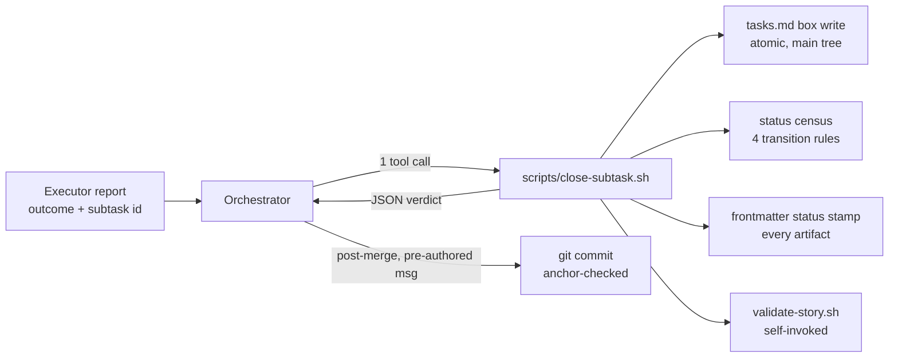

# Design - Executor-Owns-Marking (Script-Mediated Sub-task Closing)

## Overview

Move the mechanical tail of every sub-task — marking the box, running the status
census, stamping `status:`, validating — out of the orchestrator's model output
and into one deterministic script, and enforce the commit anchor the whole
git-aware lifecycle depends on. The 2026-07-23 corpus measured the cost this
design removes: 100% of 1,316 checkbox markings were written by the main loop
(the most expensive context, 60% of all output), and the anchor that makes
`story-git-status.sh` see a commit is "recommended, not enforced — nothing
gates on the shape yet" (`references/tasks.md:212`).

Two deliberate non-goals, settled at clarify: the **executor still never marks
and never commits** (marking is script-mediated, invoked by the orchestrator —
one cheap tool call replaces model-authored edits), and **commit execution
stays orchestrator-side post-merge**, preserving three standing rules
(`run-mode.md:384-385`, `agents/executor.md:117-118`, worktree merge precedes
commit) and the `hook-defer-commit.sh` CI semantics.

## Architecture

## Components & Interfaces

### 1. `scripts/close-subtask.sh` (new)

- **Responsibility:** the one sanctioned writer for closing a box in a live
  story's `tasks.md`. Marks exactly one box per invocation, runs the status
  census, stamps `status:` in every artifact carrying frontmatter, self-invokes
  validation, and reports it all as one JSON object.
- **Interface:** `close-subtask.sh <NNN|story-dir> <N.N|N|gate:<text-prefix>> [--tilde "<qualifier>: <reason>"]`
  - stdout: one JSON object `{story, task, box: "x"|"~", qualifier, census:
    {total, open, closed, deferred}, status_written: {from, to} | null,
    validate: {errors, warnings, status}}`; diagnostics on stderr.
  - `qualifier` is the bare token (`deferred` | `waived` | `n-a` |
    `superseded-by`) and `null` on a plain `[x]` close — the reason text lives
    in the file, not the JSON. Census buckets follow the one counting
    definition (`references/tasks.md#completion`): terminal `[~]` counts in
    `closed`, `deferred` counts only `deferred:` boxes.
  - Exit `0` done · `1` refused · `2` usage — the house contract
    (`archive-story.sh:81-284` pattern, single `emit_report`).
  - Refusals (exit 1, nothing written): box not found by that number; box
    already closed (idempotency — re-closing is a refusal naming the current
    state, never a silent success); `--tilde` with a qualifier outside the
    four-form grammar; story under `.epic/archive/`.
  - `--tilde` reuses the checkbox grammar verbatim (`references/tasks.md`
    Checkbox Grammar): `deferred:` / `waived:` / `n-a:` / `superseded-by:NNN`,
    written same-line as `(qualifier: reason)`.
- **Write mechanics:** atomic rewrite copied from `supersede-story.sh`'s
  `rewrite_file` (`:464-483`) — tmp file, `mv -f`, EOL preserved. The box regex
  is the shared census grammar `^[[:space:]]*- \[([ x~])\]` already used by the
  five readers; this script becomes the sixth and follows the "five readers
  move together" convention (standalone, no shared lib).
- **Status transaction (the hook gap, closed):** a Bash write to tasks.md fires
  **no hook** — PostToolUse validation matches tool `Write` only
  (`hooks/hooks.json:3-14`), and TaskCompleted keys on TodoWrite, not file
  writes. Today marking and status transition are one transaction in
  orchestrator prose (`run-mode.md:126-151`); this script makes the transaction
  real: census → apply the 4 transition rules → stamp `status:` via the
  `write_status_pair` pattern (`supersede-story.sh:725-790`) in every artifact
  with frontmatter → run `validate-story.sh` and embed its verdict in the
  output JSON. The per-marking validation the flow currently gets from the
  Write-hook is therefore preserved by construction, not lost.
- **Reason for single-box calls (settled):** parallel batch runs serialize
  closes naturally as sequential calls post-merge, and the census in the output
  JSON replaces the orchestrator re-reading tasks.md after each marking.
- **Parent-group closure (settled, single-writer principle):** validation
  errors on a `[x]` group header over an open child and on a `[ ]` header over
  zero open children (`validate-story.sh:610-657`) — so header state is not
  free. When the close leaves a group with no open children, the script closes
  the parent header **in the same atomic write**; it never closes a header any
  other way. One writer, one transaction, no window where validation sees an
  inconsistent pair.
- **Resume semantics:** the already-closed refusal (R1.3) is *benign* during a
  resumed run — the orchestrator treats "already closed" as confirmation, not
  failure. Run-mode's text says so; the script stays strict so a genuine
  double-close is never silent.

### 2. Run-mode contract change (`references/run-mode.md`)

- **Responsibility:** step 7 stops being a model-authored edit. New text: the
  orchestrator invokes `close-subtask.sh` with the outcome from the executor's
  report; the JSON's `census` and `status_written` replace the re-read; the
  archive-offer trigger keeps its exact semantics ("this run wrote `done`" —
  `run-mode.md:583`) now read from `status_written.to == "done"`.
- **Parallel runs:** tasks.md is never edited inside a worktree (unchanged —
  today's rule). Closes happen only in the main tree, sequentially, after each
  worktree merge, mirroring "merge worktrees sequentially" (`run-mode.md:546`).
- **The `failed` outcome makes no close call:** an executor report carrying
  `failed` routes through the existing step-6 FAIL path (report to user, ask
  how to proceed) — the box stays open, nothing is written. The enum's third
  arm is consumed here, by not closing.
- **Trivial complexity inline path:** the main agent, acting as single author,
  also closes via the script — one grammar writer everywhere.

### 3. Executor report contract (`agents/executor.md`)

- **Responsibility:** the step-6 report gains a machine-liftable closing block
  the orchestrator forwards verbatim to the script: sub-task id, outcome
  (`done` | `close-tilde` with qualifier+reason | `failed`), and the pre-authored
  commit message it validated against. The executor's prohibition on marking
  and committing is restated, now with the reason: the script is the writer.

### 4. Anchor enforcement (authoring lint + reverse check)

- **Authoring lint (`scripts/validate-story.sh`):** every `Commit:` field whose
  message does not carry the story anchor — subject matching `type(NNN):` with
  the story's own zero-padded-or-not number — draws a **warning** naming the
  expected shape. Warning, not error: foreign formats stay usable, but drift is
  no longer silent. Fast/spike stories included (they commit too).
- **Reverse check (extend `scripts/story-git-status.sh`):** a new
  `anchored_commits` field — count of subjects reachable from **HEAD** (not
  main; the branch is where a just-finished story lives) matching the existing
  `MSG_CONV_RE` / `MSG_SLUG_RE` token rules (`:774-790`). The anchor regexes
  keep their single home. `validate-mode` consumes it: story `done|validated`
  with `anchored_commits == 0` → warning "this story's commits carry no (NNN)
  anchor — integration detection cannot see them". Complements 006's
  `integrated` check (that one asks *did it reach main*; this one asks *is the
  work findable at all*). Non-blocking, per the standing lifecycle decision.
- **No double-fire with 006's integration warning:** the two answer nested
  questions, so validate-mode surfaces at most one — `anchored_commits == 0`
  wins (more specific: nothing for detection to see at all); 006's
  `integrated=false` warning fires only when anchored commits exist but none
  reached main. `integrated: null` stays silent for both — "not computable
  must never dress up as a finding".
- **Placement (settled):** consumption lives in validate-mode (VALIDATE runs
  only), **not** in `validate-story.sh` — that script runs on every
  TaskCompleted hook, where a git-log sweep would tax every marking and
  `--strict` would promote the warning into a CI failure for
  legitimately-unmerged work.

### 5. Duplicated documentation surfaces (the drift set)

- **Responsibility:** the contract change lands in **every** copy, or the
  auditor's own memory flags the drift as a false finding. The set, from the
  analyst sweep: `agents/executor.md` **and** the duplicated Executor prompt
  template in `references/run-mode.md`; the persona tables in
  `skills/epic/SKILL.md`; the Executor protocol section of `ARCHITECTURE.md`;
  the sub-agent table in `README.md`; the `status:` writers list in SKILL.md's
  lifecycle-status spec (orchestrator → script); and `references/refine-mode.md`,
  which reuses the transition table — refine keeps orchestrator-side Edits for
  its own census (it never closes boxes mid-run), stated explicitly so the one
  writer of *markings* stays the script.

## Error Handling Strategy

- Script refusals are loud and specific (exit 1 + `reason` on stderr), never
  silent: the fail-open hook of the 02/07 audit is the anti-pattern this
  replaces.
- A validate failure embedded in the JSON does **not** roll back the marking —
  the box state is the truth of what happened; the orchestrator surfaces the
  embedded errors exactly as the old hook path did.
- `--tilde` reason strings are written through the atomic rewriter, never
  interpolated into a shell command or regex (injection surface: none).
- GOTCHA honored: `hook-task-completed.sh:22-31` picks the most-recently-modified
  tasks.md as "active story" — the script touches only the story it was invoked
  for, and the run-mode text warns against interleaving closes across stories
  mid-run.

## Testing Strategy

- **Unit tests (bats):** close-subtask.sh — marks `[x]`; writes `[~]` with each
  of the four qualifiers; refuses: unknown box, already-closed box, bad
  qualifier, archived story; group-header auto-close on the last child (open
  sibling holds it open; terminal `[~]` children close it — R1.7);
  census/status transitions on the 004 fixture
  shapes (`in-progress`→`done`, deferred-only → no `done`); EOL preservation;
  JSON validity (jq empty) with hostile reason strings (quotes, newlines).
- **Unit tests (bats):** anchor lint — Commit field with/without `type(NNN):`;
  reverse check `anchored_commits` counting on a fixture repo (anchored subject,
  slug subject, bare-number subject must NOT count — reuse 006's token rules).
- **Integration:** a scripted mini-run: executor-report JSON → close call →
  tasks.md diff + status stamp + embedded validate verdict asserted together.
- **E2E:** none (tool: none) — plugin has no runnable application surface;
  the integration layer above is the outermost real boundary.

## Tooling Decisions

- E2E tool: none — not a web project; test harness is `bats` (local checkout)
- Frontend aid: none
- Recommendation surfaced: no

## Integration Points

- `scripts/archive-story.sh` / `supersede-story.sh`: unchanged; close-subtask
  copies their write patterns (`rewrite_file`, `write_status_pair`, census).
- `scripts/story-git-status.sh`: gains `anchored_commits` (additive JSON field —
  existing consumers unaffected; the count-key freeze rule — story 006's R5.1 —
  applies to validate-story.sh's JSON, not this one; noted so the suite pins
  it).
- `hooks/hooks.json`: unchanged — the script self-validates instead of relying
  on Write-hooks that Bash writes cannot fire.
- Story 015 (this wave): converts `Commit` sub-tasks to group-level fields; the
  authoring lint in component 4 reads the **field**, either shape, during the
  transition — the lint must not assume the checkbox form 015 removes.
