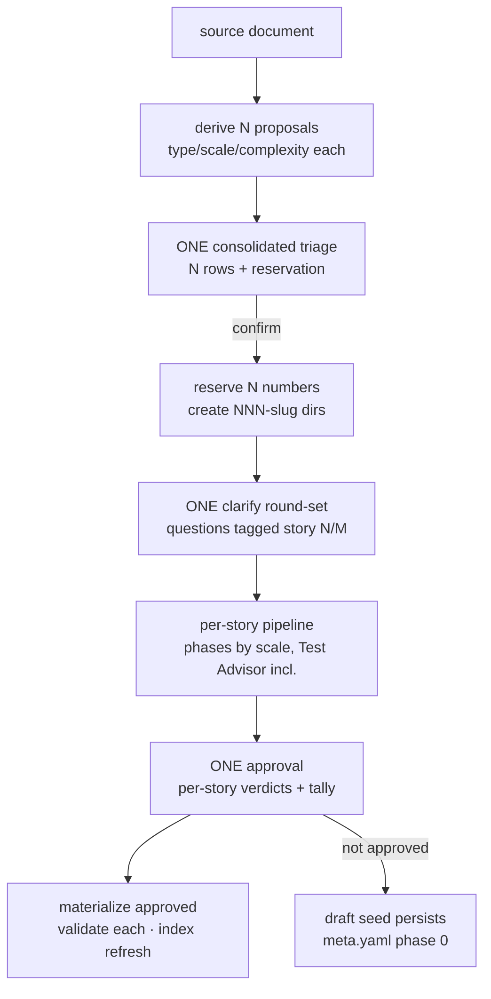

# Design - Quick-Create (Batch Story Creation from a Source Document)

## Overview

One interview, N stories. The corpus measured creating a story in isolation at
~951k fresh tokens against 163-366k per story in batch — the difference is the
interview, which repeats wholesale for every isolated create while 39% of
create-mode output happens before the first artifact touches disk. This design
adds `stories create --batch <doc>`: derive N story proposals from a source
document (typically an audit report — the proven audit→wave pipeline), run ONE
consolidated triage and ONE clarify round-set, then materialize every approved
story through the normal per-scale pipeline. Nothing about a single story's
quality contract changes — batch amortizes the conversation, not the phases.

## Architecture

## Components & Interfaces

### 1. Routing and mode reference

- **Responsibility:** `stories create --batch <doc>` enters BATCH-CREATE mode.
- **Interface:** new arm in the SKILL routing cascade, placed so it matches
  **before** the bare `"stories"` LIST arm (the cascade is prefix-loose; order
  is the guard). `argument-hint` and the Mode Dispatch table gain the entry,
  dispatching to a new `references/batch-create.md` — consistent with every
  other mode living in its own reference.
- **Scope:** `<doc>` is a path (audit report, proposal document, improvement
  plan). A batch without a document is out of scope — the inline-list variant
  was explicitly deferred at clarify.

### 2. Derivation and consolidated triage

- **Responsibility:** read the document, propose N stories — each with event,
  type, complexity and scale from the existing triage table, applied per
  proposal (a batch may mix Fast/Standard/Full).
- **Interface:** ONE triage block: N rows + shared context (runtime precheck,
  MCP health-check, preferred tooling — detected **once** for the batch, not N
  times) + "Confirm or adjust?" once. The agent-teams proposal never fires
  during batch (it belongs to each story's Run).
- Derived stories cross-link the source: each story.md's Related Stories names
  the document (and the audited story, when the doc audits one).

### 3. Number reservation (race-closed)

- **Responsibility:** allocate N consecutive numbers exactly once.
- **Mechanics:** on triage confirmation, scan `.epic/stories/` AND
  `.epic/archive/` for the highest number (the house rule), then **create all
  N placeholder directories `NNN-reserved/` immediately** — directory
  existence is the reservation, the same primitive that makes numbers
  never-recycled — and rename each placeholder to its real `NNN-slug/` in the
  same confirmation step. A concurrent create between scan and mkdir is
  detected by re-scanning after creation; on collision the batch re-slots the
  tail (the allocator may remove **its own** colliding placeholder while
  re-slotting — a **foreign** directory is never removed or overwritten) and
  says so. A crash between reserve and rename leaves `NNN-reserved/` dirs on
  disk; resume detection recognizes them as an interrupted reservation
  (component 6). 999-cap message unchanged.
- **New helper: `scripts/next-story-number.sh`** — the scan-and-allocate,
  extracted to a script (`next-story-number.sh [--reserve N]` → JSON
  `{next, reserved: [], collisions: []}` — all three keys are the contract),
  because prose-only allocation is exactly the kind of unexercised contract
  this plugin's audits keep finding. Single create uses it too — one
  allocator, tested.

### 4. Consolidated interview

- **Responsibility:** every clarification for every Standard/Full member, in
  one round-set.
- **Mechanics:** questions tagged `[story N/M — slug]`, bundled 3-7 per
  AskUserQuestion call, as many calls as needed but **≤3 rounds for the whole
  batch** (the existing cap, applied globally — remaining ambiguity becomes
  documented assumptions, the existing rule). Fast members skip clarify per
  their carve-out. Headless: the assertion-style numbered list covers the
  batch; no pause — assumptions are logged and the flow proceeds.

### 5. Per-story pipeline, unabridged

- **Responsibility:** each approved story runs its scale's normal phases —
  batch collapses conversation, never contract.
- The non-negotiable: **Phase 3 runs the Test Advisor per Standard/Full
  member** (authored tests + red-evidence). A batch that skipped it would ship
  stories Run mode refuses at the materialization guard (`run-mode.md:18`).
  Advisors for independent stories may run in parallel.
- Every materialized story must pass `validate-story.sh` clean — including
  story 014's EARS checks once that wave-sibling lands (generated criteria are
  Rn.m-labeled by construction; this is the acceptance test that proves it).
- Story 014's authoring ceiling fires **per generated story**; in batch mode
  the split offer is *not* re-entered into the live interview — the warning
  surfaces in the approval block and a split happens post-batch as a regular
  create (decided here; batch-create.md states it).

### 6. One approval, per-story verdicts

- **Responsibility:** the batch ends with one decision moment.
- **Interface:** reuses the LIST batch grammar — one verdict per story, a
  batch never stops on one, closing one-line tally. Verdicts: `created`
  (materialized, validated), `skipped` (user declined — the reserved dir
  persists as a **draft seed**: `.draft/meta.yaml` with `phase: 0`, the
  proposal, and the **`source-doc:` path** it derived from, so resume
  detection recovers it and the number stays honest),
  `blocked` (validation failed — artifacts stay in `.draft/`, nothing
  materialized). Materialization writes `status: draft` frontmatter and
  refreshes the index (`epic-index.sh`, idempotent, non-gating).
- **Resume:** a batch interrupted mid-flight is N ordinary per-story drafts
  plus their `meta.yaml` phase markers — resume detection stays per-story
  (the existing mechanism), with batch-create.md adding the aggregated line
  ("batch draft found: K of N approved") grouping drafts by the persisted
  `source-doc:` field — the producer writes exactly what this consumer reads.
  Leftover `NNN-reserved/` placeholders (a crash between reserve and rename)
  are recognized as an interrupted reservation and offered for cleanup or
  completion.

## Error Handling Strategy

- Unreadable/empty source document: refuse before any reservation, exit-style
  message naming the path.
- Derivation finds zero story-shaped items: report it and stop — never invent
  stories to fill a batch.
- Collision at re-scan: re-slot tail numbers, name the collision; never
  remove or overwrite a foreign directory (the allocator may re-slot away its
  own placeholder).
- Allocator refuses at the 999 cap (exit 1): the batch flow surfaces the
  existing maximum-story-count message and stops before the interview —
  nothing is reserved.
- A member failing validation at materialization: verdict `blocked`, batch
  continues (the LIST grammar's rule), tally shows it.

## Testing Strategy

- **Unit tests (bats):** `next-story-number.sh` — max across stories+archive;
  `--reserve N` returns N consecutive; zero-padding; 999 cap; empty project
  starts at 001; collision-safe re-scan (pre-created dir mid-test).
- **Integration:** none scripted — the flow is orchestrator prose; its
  verification is the routing eval plus the dogfood batch (this wave's own
  backlog is the natural first run).
- **E2E:** none (tool: none).

## Tooling Decisions

- E2E tool: none — not a web project; test harness is `bats` (local checkout)
- Frontend aid: none
- Recommendation surfaced: no

## Integration Points

- `skills/epic/SKILL.md`: routing cascade (order-sensitive), argument-hint,
  Mode Dispatch, Output Rules (allocation now via the helper).
- `references/list-mode.md`: verdict grammar reused verbatim — batch-create.md
  cites it as the single definition rather than restating.
- `scripts/epic-index.sh`: refresh at materialization (existing idempotent
  pattern).
- `evals/trigger-queries.json`: routing eval for the new arm.
- Wave siblings: 014 (ceiling per story, split deferred post-batch — stated in
  batch-create.md) and 010/015 (generated tasks.md uses whatever Commit-field
  shape references/tasks.md prescribes at generation time — batch-create.md
  adds nothing of its own).
