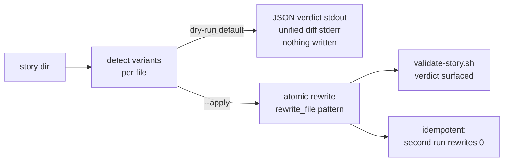

# Design - Epic Migrate and the Commit Field

## Overview

Two moves that only make sense together. First, `epic migrate`: a normalizer
for the legacy variants the corpus catalogued — 17 tasks.md files invisible to
every parser (`## T1`/`Covers:` house style), checkbox-less plans, leaked
`</content>` wrapper tags, `Requirements:` fields dangling in fast-scale
stories. Converting dialects once is cheaper than teaching every reader all
dialects forever (the shidashi precedent: one story normalized in a single
352+/161− commit). Second, the template change migrate must also carry:
`Commit` stops being a checkbox sub-task — 12% of the corpus's checkboxes,
and the single largest source of false-partial stories — and becomes a
group-level `Commit:` field. A non-checkbox line is elided from every census
**by construction** (census regexes match `- [` lines only), so no parser
needs a Commit carve-out; what moves is run-mode's ordering prose.

## Architecture

## Components & Interfaces

### 1. `scripts/migrate-story.sh` (new) + `bin/epic-migrate`

- **Responsibility:** detect and rewrite the known legacy variants of one
  story, provably and reversibly (dry-run first, diff always).
- **Interface:** `migrate-story.sh <NNN|story-dir> [--apply]`
  - Dry-run is the **default** (clarify decision): JSON verdict on stdout
    `{story, applied: false, changed_files: [], rewrites: {t1_headers, covers_fields,
    boxes_added, wrapper_tags, fast_requirements, commit_subtasks}, validate: null}`,
    human-readable unified diff on **stderr** — stdout stays one JSON object,
    the house contract; a pure-diff stdout would be the repo's only exception.
    `changed_files` lists the files that **would** change on a dry-run and the
    files that **did** change under `--apply` — same key, tense follows
    `applied`.
  - `--apply`: atomic rewrites via the `rewrite_file` pattern
    (`supersede-story.sh:464-483`), then run `validate-story.sh` and embed its
    verdict — migration is proven, not assumed.
  - Exit 0 = clean or migrated · 1 = refused (archive, unparseable mixture) ·
    2 = usage. Refuses `.epic/archive/**` (the guard blocks tools, not Bash —
    the script self-refuses, same stance as close-subtask).
  - Per-story invocation; a `--all` sweep belongs to the mode prose, per the
    ARCHIVE precedent.
- **Idempotency by grammar, never by marker:** already-canonical lines match
  no detector; second `--apply` reports `rewrites: 0` and produces no diff.
  Frontmatter `version:` bumps only when something changed.
- **Byte discipline:** CRLF preserved (the `${line%$'\r'}` handling), fence
  tracking copied from `validate-story.sh:514-528` — a wrapper tag or a `## T1`
  inside a fenced example is documentation, not a variant.
- **Frontmatter dialect:** the majority (CRLF-tolerant, comment-stripping)
  reader — `archive-story.sh`/`cross-reference.sh:142-161` — NOT
  validate-story.sh's minority dialect (the registered Known Divergence).
- **Never renumbers:** removing a `1.3 - Commit` sub-task leaves a gap in the
  numbering. Gaps are legal; renumbering would break every provenance pointer
  (`deviations.yaml`, `red-evidence.yaml`, REQ_MAP, `Dependencies: Task 1.2`).
- **Unparseable mixture:** refuse with the offending lines named — "not
  computable must never dress up as a finding"; migrate never guesses.

### 2. The five variant rewriters (one pass, one detector table)

| # | Variant (corpus source) | Rewrite |
|---|---|---|
| 1 | `## T1`/`### T2` headers + `Covers:` fields (bentoolkit ×17) | canonical `- [ ] N - Name` boxes + `- Requirements:` lines; detection regexes already exist as hints (`validate-story.sh:670-674`) |
| 2 | checkbox-less task lists | boxes added as `[ ]` — **the honest default**: migrate records shape, never invents done-ness |
| 3 | leaked `</content>`/`</invoke>` wrapper tags (thiago ×15) | stripped, fence-aware |
| 4 | `Requirements:`/R-tokens in fast/spike stories (wakeru 036) | removed — only when the **resolved** scale (tasks.md authoritative) is fast/spike; a `satisfied-by:` suffix is never stripped (story 014 interference, decided here) |
| 5 | Commit checkbox sub-tasks | group-level `Commit:` field (below); inline Commit fields already canonical, untouched |

Single-pass line rewriter with a variant-detector table up front — per-variant
separate rewriters would multiply the regression surface for no gain.

### 3. Template change: `Commit:` becomes a group field

- **Grammar:** the parent task body gains `- Commit: "type(NNN): subject"` as
  a metadata-adjacent field; the checkbox sub-task form disappears from the
  template. Single-sub-task groups keep the inline form (already a field).
  The story-anchor recommendation (`type(NNN):`) moves with it, unchanged —
  it is what `story-git-status.sh` and story 010's checks read.
- **Why the census needs no carve-out:** every census site matches
  `- [`-prefixed lines; a `- Commit:` field line is invisible to all of them
  by construction (`run-mode.md:220` already states this for inline fields).
  Removing Commit boxes therefore shrinks `total`/`closed` — consequences
  stated, not discovered:
  - **Archive manifest counters** change only for **newly archived** stories;
    existing manifest entries are a snapshot, documented as permanent, and the
    rewrite parser never re-derives them.
  - **Dependency satisfaction:** a group is satisfied when every box is closed
    — with no Commit box, satisfaction no longer waits on the commit, which
    matches reality: the dependent task needs the code, and the code exists at
    merge, not at commit.
  - **Ordering with story 010 (the wave's one hard interplay):** rule-1 `done`
    can now fire when the last *implementing* box closes, **before** the
    group's commit runs. Run-mode's ordering is respecified: close boxes →
    status census (may write `done`) → execute the group's `Commit:` field →
    archive offer. 010's reverse anchor check already tolerates the
    just-finished-not-yet-committed window (warning-only, evaluated at
    VALIDATE, not at close). 010's **authoring lint** reads **both** Commit
    shapes from day one (its design §4), so landing order inside the wave
    cannot strand either story.
- **Consumer inventory (the sweep, every copy):** `references/tasks.md`
  (template :46-48, field table :160, §Commit Sub-tasks :206-212 retitled,
  Rule 10 :234, Gotchas :255, Fast adaptations :264, Acceptance note :203);
  `references/run-mode.md` (`--gate=commit` :31, §Commit Sub-tasks :222-224,
  parallel rule :551, tech-review skip :462, Rules :566, **and the prose
  copies at :384 "Commits are handled by the orchestrator via Commit
  sub-tasks" and :546 "run Commit sub-task for the group"**);
  `references/phase-gates.md:160,175,220` (Commit-sub-task test exemptions);
  `agents/test-advisor.md:139,142` (same exemption prose);
  `references/list-mode.md:235,251` (checkbox-shaped example lines);
  `references/validate-mode.md:28`
  + `agents/validator.md:26,35` (verify commit per group field, SKIP arm);
  all four `assets/examples/*.md`; `scripts/validate-story.sh:757-763`
  (`COMMIT_COUNT` **already accepts the field form** — add the warning-level
  nudge that a checkbox Commit sub-task is the legacy shape migrate converts).
  `cross-reference.sh` needs nothing: Commit headings advancing CURRENT_TASK
  is harmless in both shapes — this design paragraph IS the note's home,
  deliberately; no other artifact carries it.

## Error Handling Strategy

- Refusal arms are loud: archive target, unparseable mixture, unknown story —
  exit 1, reason on stderr, `applied: false` JSON intact.
- A failed validate after `--apply` is surfaced in the JSON, never swallowed;
  the rewrite stands (the diff was approved by invocation) and the errors name
  what to fix — same no-rollback stance as story 010. **Exit stays 0**: the
  migration itself succeeded; the embedded verdict is the channel for what it
  uncovered.
- Unknown story (no `.epic/stories/NNN-*` match): refusal, exit 1, nothing
  emitted but the reason.
- Unreadable file in the story: refuse before emitting a partial diff —
  dry-run included.
- Diff-only failure mode (dry-run on unreadable file): refuse before emitting
  a partial diff.

## Testing Strategy

- **Unit tests (bats):** one fixture per variant × (dry-run diff + nothing
  written, `--apply` result, idempotent second run); archive refusal;
  fence-immunity for variants 1 and 3; no-renumber invariant (gap survives);
  fast-Requirements removal keyed to resolved scale; `satisfied-by:` survives
  variant 4; CRLF fixture byte-clean.
- **Integration:** the all-variants fixture — one story carrying all five —
  migrate `--apply` → validate clean → second run `rewrites: 0`.
- **Extended suites:** `tests/validate-story.bats` (field-only story raises no
  commit warning; legacy checkbox raises the nudge), `tests/archive-story.bats`
  (counters on a field-form story), `tests/checkbox-grammar.bats` sanity.
- **E2E:** none (tool: none).

## Tooling Decisions

- E2E tool: none — not a web project; test harness is `bats` (local checkout)
- Frontend aid: none
- Recommendation surfaced: no

## Integration Points

- `bin/epic-migrate` → 4-line exec wrapper, the `bin/epic-validate` pattern.
- Story 010: close script parses both Commit shapes (its design already says
  so); run-mode ordering respecified here is the same file 010 edits — the
  wave sequences 010 before 015, and 015 rebases its run-mode edit on 010's.
- Story 014: variant-4 remover preserves `satisfied-by:`; migrate runs 014's
  checks via the embedded validate, so a migrated story is proven against the
  new lint in the same command.
- `skills/epic/SKILL.md`: routing gains `stories migrate NNN [--apply]` +
  Mode Dispatch row.
